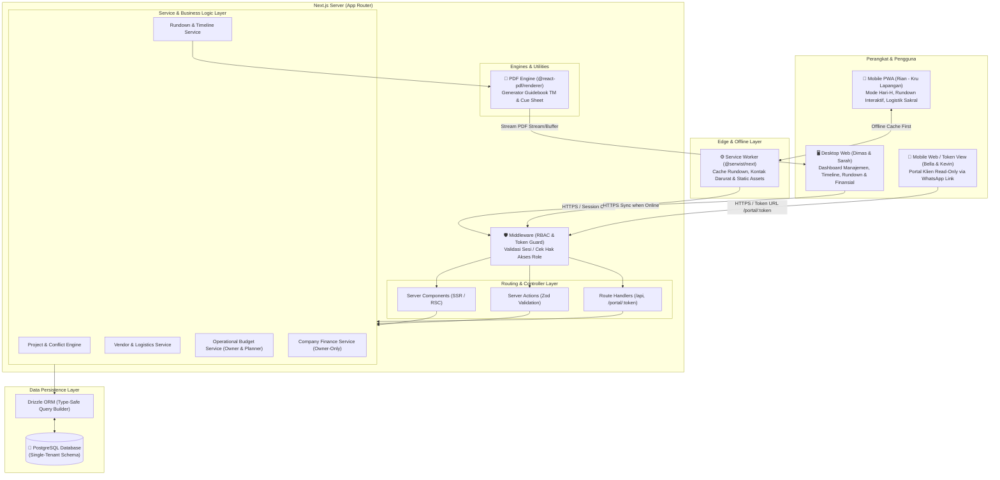
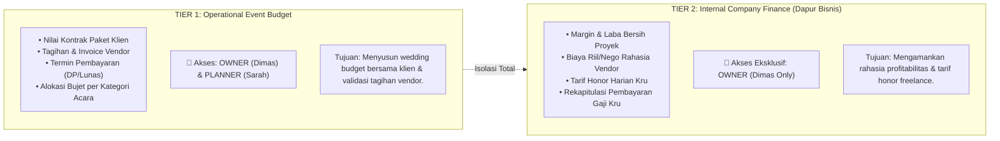

# Sistem Manajemen Operasional Wedding Organizer (Single-Tenant)
## Software & System Architecture Document

Dokumen ini mendefinisikan arsitektur sistem, topologi aliran data, standar implementasi teknis, serta batasan privasi berdasarkan [userpersona.md](file:///D:/PROJECT/WO/userpersona.md), [requirements.md](file:///D:/PROJECT/WO/requirements.md), dan aturan pengkodean [.agyrules](file:///D:/PROJECT/WO/.agyrules).

---

## 1. High-Level Architecture Diagram

Sistem menggunakan arsitektur **Single-Tenant Fullstack Next.js** yang melayani empat profil pengguna dengan kebutuhan perangkat dan konteks akses yang berbeda:



---

## 2. Core Tech Stack Specification

| Komponen | Teknologi | Justifikasi Teknis |
| :--- | :--- | :--- |
| **Framework** | **Next.js (App Router)** | Mendukung *React Server Components (RSC)* untuk *zero client bundle overhead*, *Server Actions* sebagai mutasi data tanpa boilerplate API terpisah, dan *Route Handlers* untuk dokumen streaming. |
| **Bahasa** | **TypeScript (Strict Mode)** | Menjamin *type-safety* end-to-end dari basis data hingga komponen UI. Larangan keras menggunakan tipe `any`. |
| **Database** | **PostgreSQL** | Database relasional berkinerja tinggi, menjamin konsistensi ACID saat validasi anti-bentrok jadwal kru dan pencatatan transaksi vendor. |
| **ORM / Query Builder** | **Drizzle ORM** | Ringan (*zero runtime overhead*), tidak memerlukan proses binary compiler seperti Prisma, *type-safe*, dan kompatibel dengan edge/serverless runtime. |
| **Styling & UI Kit** | **Tailwind CSS + Shadcn UI** | Komponen UI berbasis Radix UI Primitives yang sepenuhnya dapat dikustomisasi, aksesibel, dan teroptimasi untuk tema responsif (desktop & mobile). |
| **Validasi & Kontrak Data** | **Zod** | *Single source of truth* validasi data untuk form input, argumen Server Actions, dan parameter URL. |
| **Dokumen & Cetak** | **`@react-pdf/renderer`** | Menghasilkan Buku Panduan Acara (Guidebook TM) dan Lembar Kerja *Cue Sheet* format PDF secara langsung di server menggunakan sintaks komponen React. |
| **Offline-First Resilience** | **`@serwist/next` (Service Worker)** | Menyimpan data statis, lembar rundown, kontak darurat, dan *checklist* barang di *Cache Storage* ponsel agar tetap dapat diakses kru lapangan di area basement/ballroom tanpa sinyal. |
| **Format Tanggal Acara** | **`date-fns` (Locale `id`)** | Modul format penanggalan dan waktu Indonesia untuk susunan acara menit-per-menit ("Sabtu, 24 Oktober 2026", "WIB"). |

---

## 3. Konfirmasi Arsitektur Single-Tenant

Sistem ini didesain dan dioperasikan khusus secara **Single-Tenant** untuk 1 instansi Wedding Organizer internal.

### Prinsip Utama Single-Tenant:
1. **Tidak Ada Kolom `tenant_id`:** Seluruh tabel database (misal: `projects`, `crews`, `vendors`, `rundowns`) beroperasi langsung pada domain bisnis tanpa *partitioning foreign key* `tenant_id`.
2. **Tidak Ada Tabel `tenants` atau `organizations`:** Meniadakan beban kompleksitas multi-tenancy, middleware filtering per tenant, dan risiko kebocoran data antar-organisasi (*cross-tenant data leakage*).
3. **Kinerja & Integritas Relasional Penuh:** Pemanfaatan *Foreign Key* dan *Unique Constraints* PostgreSQL secara alami (contoh: validasi bentrok kru hanya perlu mengecek tabel `project_crews` dan waktu acara tanpa klausa filter tenant).

---

## 4. Dual-Tier Financial Boundary (Pola Pemisahan Finansial)

Untuk memenuhi aturan keamanan di [.agyrules](file:///D:/PROJECT/WO/.agyrules), sistem menerapkan **Dual-Tier Financial Boundary** yang memisahkan antara **Bujet Operasional Acara** dan **Keuangan Internal/Dapur Bisnis Kantor**.



### Strategi Isolasi pada Kode:
1. **Pemisahan Modul Layanan (Service Layer Isolation):**
   - `src/services/budget-service.ts`: Hanya menangani kalkulasi bujet acara, invoice vendor, dan pencatatan pembayaran klien (dapat diakses role `OWNER` dan `PLANNER`).
   - `src/services/finance-service.ts`: Menangani margin keuntungan kantor, kalkulasi honor kru, dan rekapitulasi penggajian (wajib memvalidasi role `OWNER` sebelum mengeksekusi query).
2. **DTO Projection Pattern:**
   - Dilarang keras melakukan query `SELECT *` pada data keuangan.
   - Response DTO untuk role `PLANNER` wajib menyaring field biaya internal sehingga hanya menampilkan status pembayaran (`is_paid`, `status: 'SETTLED' | 'PENDING'`).
   - Role `CREW` dan `CLIENT` sama sekali tidak memiliki akses ke kedua service keuangan di atas.

---

## 5. Directory Structure (Modular per Fitur)

Struktur folder mengadopsi pendekatan modular berbasis fitur di bawah arsitektur Next.js App Router:

```text
D:\PROJECT\WO\
├── .agyrules                         # Aturan arsitektur & coding standards
├── architecture.md                   # Dokumen spesifikasi arsitektur
├── requirements.md                   # Dokumen spesifikasi kebutuhan (SRS)
├── userpersona.md                    # Analisis persona pengguna
├── revisipersona.md                  # Catatan revisi teknis persona
├── package.json
├── tsconfig.json
├── next.config.mjs
├── tailwind.config.ts
│
├── public/                           # Aset publik statis & manifest PWA
│   ├── icons/                        # Ikon PWA
│   ├── manifest.json                 # Web App Manifest
│   └── sw.js                         # Service Worker output
│
└── src/
    ├── app/                          # Next.js App Router
    │   ├── layout.tsx                # Root layout & providers
    │   ├── page.tsx                  # Landing / redirect
    │   │
    │   ├── (auth)/                   # Rute Autentikasi Internal
    │   │   ├── login/
    │   │   └── layout.tsx
    │   │
    │   ├── (admin)/                  # Rute Kantor (Dimas & Sarah)
    │   │   ├── layout.tsx            # Sidebar admin, header & auth check
    │   │   ├── dashboard/            # Kalender multi-acara & ringkasan operasional
    │   │   ├── projects/             # Daftar proyek pengantin
    │   │   │   └── [projectId]/
    │   │   │       ├── overview/     # Ringkasan acara & timeline H-6 bulan
    │   │   │       ├── squad/        # Alokasi tim & validasi anti-bentrok
    │   │   │       ├── vendors/      # Slotting vendor & integrasi WhatsApp
    │   │   │       ├── family/       # Direktori keluarga inti & saksi nikah
    │   │   │       ├── rundown/      # Master rundown & cue sheet builder
    │   │   │       ├── vault/        # Document vault (layout venue, perizinan)
    │   │   │       └── budget/       # Tier 1: Bujet operasional acara (Sarah & Dimas)
    │   │   ├── templates/            # Pustaka template prosesi adat & agama
    │   │   └── vendors/              # Master katalog rekanan vendor
    │   │
    │   ├── (owner-only)/             # Rute Finansial Dapur Bisnis (Eksklusif Dimas)
    │   │   ├── layout.tsx            # RBAC Guard ketat (Khusus Role OWNER)
    │   │   └── finance/
    │   │       ├── margins/          # Rekapitulasi margin & laba kotor proyek
    │   │       ├── crew-honor/       # Kalkulator honor kru harian & batch payout
    │   │       └── packages/         # Katalog paket layanan & SOW boundaries
    │   │
    │   ├── (mobile)/                 # Rute Mobile PWA Hari-H (Rian - Kru Lapangan)
    │   │   ├── layout.tsx            # Mobile-optimized shell (tanpa sidebar desktop)
    │   │   └── field/[projectId]/
    │   │       ├── rundown/          # Interactive rundown (Now & Next indicator)
    │   │       ├── logistics/        # Pelacak barang sakral (cincin, mahar)
    │   │       └── emergency/        # Speed-dial kontak PIC vendor & keluarga
    │   │
    │   ├── (public)/                 # Rute Publik / Guest View (Bella & Kevin)
    │   │   └── portal/[token]/       # Magic link read-only (Progress & Countdown)
    │   │
    │   └── api/                      # Route Handlers
    │       ├── pdf/[projectId]/      # Streaming PDF Guidebook TM
    │       └── auth/[...nextauth]/   # Auth.js endpoint
    │
    ├── actions/                      # Server Actions (Thin Controller + Zod)
    │   ├── project-actions.ts
    │   ├── crew-actions.ts
    │   ├── rundown-actions.ts
    │   ├── budget-actions.ts         # Server actions untuk bujet operasional
    │   └── finance-actions.ts        # Server actions khusus keuangan internal (Owner)
    │
    ├── services/                     # Service Layer (Business Logic & DB Query)
    │   ├── conflict-service.ts       # Algoritma validasi anti-bentrok kru
    │   ├── project-service.ts
    │   ├── rundown-service.ts
    │   ├── budget-service.ts         # Layanan bujet acara (Tier 1)
    │   ├── finance-service.ts        # Layanan keuangan internal (Tier 2)
    │   └── pdf-service.tsx           # Template @react-pdf renderer
    │
    ├── db/                           # Drizzle ORM Database Configuration
    │   ├── index.ts                  # Koneksi database pool
    │   └── schema/                   # Skema database terpisah per domain
    │       ├── users.ts              # Akun internal (roles: OWNER, PLANNER, CREW)
    │       ├── projects.ts           # Data proyek pernikahan
    │       ├── project-crews.ts      # Relasi kru proyek & jadwal shift
    │       ├── rundowns.ts           # Item susunan acara per menit
    │       ├── vendors.ts            # Master vendor & slotting proyek
    │       ├── logistics.ts          # Pelacakan barang sakral
    │       ├── event-budgets.ts      # Skema bujet operasional acara (Tier 1)
    │       └── company-finances.ts   # Skema margin & honor kru (Tier 2)
    │
    ├── schemas/                      # Skema Validasi Zod (PascalCase *Schema)
    │   ├── project-schema.ts
    │   ├── crew-schema.ts
    │   ├── rundown-schema.ts
    │   ├── budget-schema.ts
    │   └── finance-schema.ts
    │
    ├── components/                   # Reusable UI Components
    │   ├── ui/                       # Shadcn UI primitives (button, dialog, dll.)
    │   ├── shared/                   # Komponen bersama (navbar, empty-state, loader)
    │   ├── admin/                    # Komponen khusus desktop admin
    │   ├── mobile/                   # Komponen khusus mobile kru (card swipe, quick status)
    │   └── pdf/                      # Komponen template dokumen PDF
    │
    ├── lib/                          # Library utilities & wrappers
    │   ├── auth.ts                   # Konfigurasi session & role-checker helper
    │   ├── date.ts                   # Date-fns formatters (Bahasa Indonesia)
    │   └── utils.ts                  # Helper Tailwind CSS & formatting angka
    │
    └── types/                        # TypeScript Interface & Type Definitions
        ├── action-response.ts        # Standard Envelope Result type
        ├── roles.ts                  # Role definitions
        └── models.ts                 # Domain models DTO
```

---

## 6. Ringkasan Prinsip Implementasi

1. **Anti-Conflict Priority:** Algoritma anti-bentrok dijalankan di `conflict-service.ts` sebelum data disimpan ke `project-crews.ts`.
2. **PWA Fallback:** Halaman `(mobile)/field` dilengkapi manifest dan didaftarkan ke Service Worker agar saat Rian kehilangan koneksi internet di venue, aplikasi beralih ke cache data terakhir secara transparan.
3. **Kerahasiaan Dapur Bisnis:** Rute `(owner-only)` diproteksi secara ganda di level Middleware Next.js, Layout RSC, dan di dalam `finance-service.ts`.
