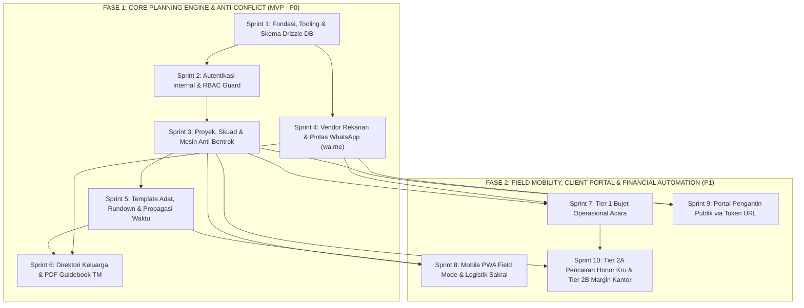

# Rencana Implementasi Bertahap (Master Phased Implementation Plan)
## Sistem Manajemen Operasional & Finansial Wedding Organizer (Single-Tenant)

Dokumen ini merupakan panduan eksekusi teknis tingkat lanjut (*step-by-step execution roadmap*) untuk membangun sistem operasional Wedding Organizer internal berdasarkan spesifikasi pada [requirements.md](file:///D:/PROJECT/altara/docs/requirements.md), [architecture.md](file:///D:/PROJECT/altara/docs/architecture.md), [schema.md](file:///D:/PROJECT/altara/docs/schema.md), [workflows.md](file:///D:/PROJECT/altara/docs/workflows.md), [rbac-security.md](file:///D:/PROJECT/altara/docs/rbac-security.md), [api-contracts.md](file:///D:/PROJECT/altara/docs/api-contracts.md), [ui-specs.md](file:///D:/PROJECT/altara/docs/ui-specs.md), dan [.agyrules](file:///D:/PROJECT/altara/.agyrules).

---

## 1. Peta Ketergantungan Antar-Fase & Sprint

---

## FASE 1: Core Planning Engine & Anti-Conflict (MVP - P0)

Tujuan: Menghadirkan sistem operasional inti bagi Dimas (Owner), Maya (Management), dan Sarah (Lead Planner / PM) untuk mendaftarkan proyek pernikahan, menunjuk Project Manager, mengalokasikan skuad kru tanpa risiko bentrok jadwal, mengelola vendor rekanan, menyusun rundown dengan template adat, serta mengekspor Buku Panduan TM (PDF).

---

### Sprint 1: Setup Fondasi, Tooling & Basis Data Drizzle (Single-Tenant)

* **Tujuan Sprint:** Menyiapkan struktur proyek Next.js App Router, konfigurasi TypeScript Strict, pustaka komponen Shadcn UI, serta skema basis data PostgreSQL Drizzle ORM tanpa kolom `tenant_id`.
* **Estimasi:** Fondasi Arsitektur
* **Status:** ✅ **SELESAI (Committed & Pushed to GitHub)**
* **Daftar Tugas:**
  - [x] **Task 1.1: Inisialisasi Proyek Next.js & TypeScript Strict**
    - Berkas: `package.json`, `tsconfig.json`, `next.config.mjs`, `tailwind.config.ts`, `.env.example`
    - Commit: `68a4845` (`feat(setup): initialize Next.js app with TypeScript strict and environment config (Task 1.1)`)
  - [x] **Task 1.2: Konfigurasi Tailwind CSS & Shadcn UI Tokens (Tema Sprig)**
    - Berkas: `src/components/ui/*`, `src/lib/utils.ts`, `components.json`, `src/app/globals.css`
    - Commit: `36afcaa` (`feat(ui): configure Tailwind CSS, Sprig theme tokens, and Shadcn UI primitives (Task 1.2)`)
  - [x] **Task 1.3: Konfigurasi Koneksi PostgreSQL & Drizzle ORM**
    - Berkas: `drizzle.config.ts`, `src/db/index.ts`
    - Commit: `acf23f1` (`feat(db): setup PostgreSQL connection and Drizzle ORM configuration (Task 1.3)`)
  - [x] **Task 1.4: Implementasi Skema Basis Data Inti (Drizzle Schemas)**
    - Berkas: `src/db/schema/*`
    - Commit: `909a4be` (`feat(schema): implement relational Drizzle database schema definitions (Task 1.4)`)
  - [x] **Task 1.5: Enforce Constraint Kritis Basis Data & Database Migration**
    - Berkas: `drizzle/0000_slow_mercury.sql`, `drizzle/meta/*`
    - Commit: `115a030` (`feat(migration): generate initial SQL migrations with anti-conflict and token constraints (Task 1.5)`)
  - [x] **Task 1.6: Seeding Data Awal (Akun & Template Adat/Agama)**
    - Berkas: `src/db/seed.ts`
    - Commit: `d9cb5b2` (`feat(seed): add database seed script for default accounts and ceremony templates (Task 1.6)`)
* **Definition of Done (DoD) Sprint 1:**
  1. Seluruh tabel relasional terbuat di PostgreSQL tanpa kegagalan migrasi.
  2. Data seed masuk sempurna (users, packages, templates).
  3. Perintah `npx tsc --noEmit` bersih tanpa error tipe data.

---

### Sprint 2: Autentikasi Internal, Sesi Cookie & Guard Otorisasi

* **Tujuan Sprint:** Mengamankan sistem dengan modul login internal kantor, sesi cookie aman (`HttpOnly`), middleware rute, dan guard otorisasi Server Actions.
* **Status:** ✅ **SELESAI (Committed & Pushed to GitHub)**
* **Daftar Tugas:**
  - [x] **Task 2.1: Standarisasi Format Respons (*Envelope Pattern*)**
    - Berkas: `src/types/action-response.ts`, `src/types/auth.ts`
    - Commit: `d3e07d6` (`feat(auth): define ActionResponse and UserSession error contracts (Task 2.1)`)
  - [x] **Task 2.2: Implementasi Modul Sesi Autentikasi (Password Hashing & Cookie)**
    - Berkas: `src/lib/session.ts`, `src/lib/auth.ts`, `tests/auth/session.test.ts`
    - Commit: `11fa13b` (`feat(auth): implement Web Crypto HMAC session signing and cookie helper (Task 2.2)`)
  - [x] **Task 2.3: Skema Zod & Server Actions Autentikasi**
    - Berkas: `src/schemas/auth-schema.ts`, `src/actions/auth-actions.ts`, `tests/auth/login-action.test.ts`
    - Commit: `f768dd1` (`feat(auth): implement login, logout, and getCurrentUser Server Actions (Task 2.3)`)
  - [x] **Task 2.4: Helper Guard Otorisasi Server Actions & Project Access**
    - Berkas: `src/lib/auth-guard.ts`, `tests/auth/auth-guard.test.ts`
    - Commit: `fc04080` (`feat(auth): implement assertRole and assertProjectAccess guards (Task 2.4)`)
  - [x] **Task 2.5: Middleware Proteksi Rute Next.js**
    - Berkas: `src/middleware.ts`
    - Commit: `e0d360b` (`feat(auth): implement Next.js route protection middleware (Task 2.5)`)
  - [x] **Task 2.6: UI Halaman & Form Login Internal (Sprig Minimalist)**
    - Berkas: `src/app/(auth)/login/page.tsx`, `src/components/auth/login-form.tsx`, `src/app/(auth)/layout.tsx`
    - Commit: `0c41e04` (`feat(auth): build responsive login UI page with demo credentials picker (Task 2.6)`)
* **Definition of Done (DoD) Sprint 2:**
  1. Pengguna dapat login dengan akun Dimas, Sarah, dan Rian lalu diarahkan ke dashboard masing-masing.
  2. Akses ke URL `(owner-only)` oleh Manajemen atau Kru otomatis ditolak (`403`).
  3. Server Actions mengembalikan `ActionError` berformat JSON standar saat unauthenticated.

---

### Sprint 3: Manajemen Proyek, Skuad & Mesin Anti-Bentrok Penjadwalan Kru

* **Tujuan Sprint:** Menyediakan fungsionalitas pendaftaran proyek pernikahan, penunjukan Lead Planner (PM), pembuatan public token instan, serta mesin validasi anti-bentrok jadwal kru.
* **Status:** ✅ **SELESAI (Committed & Pushed to GitHub)**
* **Daftar Tugas:**
  - [x] **Task 3.1: Skema Validasi Zod Proyek & Penugasan Kru**
    - Berkas: `src/schemas/project-schema.ts`, `src/schemas/crew-schema.ts`, `tests/schemas/project-crew-schema.test.ts`
    - Commit: `06d97c8` (`feat(schema): implement Zod validation schemas for projects and crew assignments (Task 3.1)`)
  - [x] **Task 3.2: Mesin Validasi Anti-Bentrok Kru (*Anti-Collision Engine*)**
    - Berkas: `src/services/crew-service.ts`, `tests/crew/anti-conflict.test.ts`
    - Commit: `5c8b008` (`feat(crew): implement anti-collision engine and crew assignment service (Task 3.2)`)
  - [x] **Task 3.3: Server Actions Proyek & Kru Skuad**
    - Berkas: `src/actions/project-actions.ts`, `src/actions/crew-actions.ts`, `tests/project/project-actions.test.ts`
    - Commit: `869205b` (`feat(actions): implement project and crew Server Actions with RBAC protection (Task 3.3)`)
  - [x] **Task 3.4: Desktop UI: Multi-Event Operational Calendar Grid**
    - Berkas: `src/components/admin/sidebar.tsx`, `src/components/admin/top-bar.tsx`, `src/app/(admin)/layout.tsx`, `src/app/(admin)/dashboard/page.tsx`, `src/components/admin/calendar-grid.tsx`, `src/components/admin/live-time-marker.tsx`
    - Commit: `dbfe1d7` (`feat(ui): build admin layout shell and multi-event operational calendar grid (Task 3.4)`)
  - [x] **Task 3.5: Desktop UI: Slide-Over Alokasi Skuad Kru**
    - Berkas: `src/app/(admin)/projects/page.tsx`, `src/app/(admin)/projects/new/page.tsx`, `src/app/(admin)/projects/[projectId]/squad/page.tsx`, `src/components/admin/project-create-form.tsx`, `src/components/admin/crew-assignment-drawer.tsx`, `src/components/admin/crew-list-table.tsx`
    - Commit: `4515eee` (`feat(ui): implement project registration form and squad allocation slide-over drawer (Task 3.5)`)
* **Definition of Done (DoD) Sprint 3:**
  1. Pembuatan proyek baru otomatis men-generate `public_token` 21 karakter URL-safe (`nanoid`).
  2. Saat Rian ditugaskan di Pernikahan A pada 24 Oktober 2026, lalu dicoba ditugaskan di Pernikahan B pada tanggal yang sama, sistem langsung memblokir dan menampilkan toast error: *"Rian sudah terjadwal bertugas di Pernikahan A pada tanggal 2026-10-24"*.
  3. Database menolak via constraint unik jika query langsung dicoba bypass.

---

### Sprint 4: Vendor Rekanan & Integrasi WhatsApp Quick-Action

* **Tujuan Sprint:** Mengelola direktori master vendor, slotting rekanan ke dalam proyek pengantin, dan integrasi tautan pesan instan WhatsApp otomatis.
* **Daftar Tugas:**
  - [x] **Task 4.1: Helper Sanitasi Nomor & Generator Deep-Link WhatsApp**
    - Berkas: `src/lib/whatsapp.ts`
    - Fungsi: `sanitizeIndonesianPhone` (konversi `08...`/`+628...` ke `628...`) dan `generateVendorTmWhatsappUrl(draft)` dengan `encodeURIComponent`.
  - [x] **Task 4.2: Skema Zod & Service Vendor**
    - Berkas: `src/schemas/vendor-schema.ts`, `src/services/vendor-service.ts`
    - Fitur: CRUD master vendor, slotting vendor ke `project_vendors`, filter kategori (MUA, Dekorasi, Katering, Foto, Sound, dll.).
  - [x] **Task 4.3: Server Actions Vendor & Slotting Acara**
    - Berkas: `src/actions/vendor-actions.ts`
    - Fungsi: `createVendorAction`, `slotVendorToProjectAction`, `updateVendorStatusAction`.
  - [x] **Task 4.4: Desktop UI: Master Katalog Vendor Rekanan**
    - Berkas: `src/app/(admin)/vendors/page.tsx`, `src/components/admin/vendor-form-dialog.tsx`
    - Tampilan: Tabel master vendor, filter kategori, badge status keaktifan, dan tombol kontak WhatsApp.
  - [x] **Task 4.5: Desktop UI: Slide-Over Slotting Vendor Proyek**
    - Berkas: `src/app/(admin)/projects/[projectId]/vendors/page.tsx`, `src/components/admin/vendor-slot-card.tsx`
    - Fitur: Pemetaan slot vendor per kebutuhan acara pengantin, tombol 1-klik buka WhatsApp untuk undangan Technical Meeting (TM).
* **Definition of Done (DoD) Sprint 4:**
  1. Lead Planner atau Manajemen dapat menambahkan vendor ke slot proyek pernikahan pengantin.
  2. Menekan tombol WhatsApp langsung membuka tautan `https://wa.me/628...` dengan draf teks undangan TM yang sudah memuat nama pengantin, tanggal, jam, dan lokasi venue.

---

### Sprint 5: Pustaka Template Prosesi, Rundown Builder & Propagasi Waktu

* **Tujuan Sprint:** Membangun antarmuka penyusunan rundown menit-per-menit (*cue sheet*), pustaka template adat/agama, dan mesin pergeseran waktu berantai.
* **Daftar Tugas:**
  - [x] **Task 5.1: Mesin Propagasi Waktu Berantai (*Time Propagation Engine*)**
    - Berkas: `src/services/rundown-service.ts`, `src/lib/rundown-time.ts`
    - Algoritma: `propagateRundownTimes(items, initialStartTime)` mengkalkulasi ulang `startTime` dan `endTime` seluruh sesi berikutnya secara otomatis jika ada durasi yang bergeser.
  - [x] **Task 5.2: Duplikasi Template Prosesi ke Proyek**
    - Berkas: `src/services/template-service.ts`
    - Logika: Menyalin kumpulan `template_rundown_items` ke dalam `project_rundowns` dengan penyesuaian jam awal acara pengantin.
  - [x] **Task 5.3: Server Actions Rundown & Template**
    - Berkas: `src/schemas/rundown-schema.ts`, `src/actions/rundown-actions.ts`
    - Fungsi: `applyTemplateToProjectAction`, `reorderRundownAction`, `updateRundownItemAction`, `createRundownItemAction`.
  - [x] **Task 5.4: Desktop UI: Master Rundown Builder (Dense Table & Cue Sheet)**
    - Berkas: `src/app/(admin)/projects/[projectId]/rundown/page.tsx`, `src/components/admin/rundown-table.tsx`, `src/components/admin/cue-sheet-badges.tsx`
    - Tampilan: Tabel padat, badge Audio/Lagu (`Headphones`), Lighting (`SunMedium`), avatar PIC kru, dan dialog edit durasi.
* **Definition of Done (DoD) Sprint 5:**
  1. Lead Planner dapat menerapkan template prosesi Akad Sunda ke proyek pengantin baru dalam 1 klik.
  2. Mengubah durasi sesi Akad dari 60 menit menjadi 75 menit otomatis memajukan jam mulai sesi Sungkeman dan sesi berikutnya sejauh 15 menit secara akurat.

---

### Sprint 6: Direktori Keluarga/VIP & Generator PDF Guidebook TM

* **Tujuan Sprint:** Mengelola susunan keluarga inti/saksi nikah dan mengekspor Buku Panduan Acara (Guidebook TM) format PDF siap cetak.
* **Daftar Tugas:**
  - [x] **Task 6.1: Service & Server Actions Direktori Keluarga Inti & VIP**
    - Berkas: `src/schemas/wedding-party-schema.ts`, `src/services/wedding-party-service.ts`, `src/actions/wedding-party-actions.ts`
    - Fitur: CRUD data orang tua, saksi nikah, pengiring, dan nomor kontak darurat keluarga.
  - [x] **Task 6.2: Service Agregator Data Guidebook TM**
    - Berkas: `src/types/guidebook-dto.ts`, `src/services/pdf-aggregator-service.ts`
    - Fungsi: `aggregateGuidebookData(projectId)` mengumpulkan data proyek, venue, vendor terpasang, keluarga inti, dan susunan rundown cue-sheet menjadi satu DTO terstruktur (bebas data biaya sensitif).
  - [x] **Task 6.3: Template PDF Komponen `@react-pdf/renderer`**
    - Berkas: `src/components/pdf/guidebook-template.tsx`, `src/components/pdf/pdf-styles.ts`
    - Desain dokumen: Cover elegan nama pengantin, halaman kontak darurat & keluarga, halaman pemetaan vendor, dan lembar kerja rundown cue-sheet per sesi.
  - [x] **Task 6.4: Route Handler Streaming Dokumen PDF**
    - Berkas: `src/app/api/pdf/guidebook/[projectId]/route.ts`
    - Endpoint: `GET /api/pdf/guidebook/:projectId` dengan header `Content-Type: application/pdf` dan `Content-Disposition: attachment; filename="Guidebook-TM-..."`.
  - [x] **Task 6.5: Tombol Cetak Dokumen di Header Rundown**
    - Berkas: `src/components/admin/family-directory-drawer.tsx`, `src/components/admin/project-rundown-client.tsx`
    - Tombol: *"Download Guidebook TM (PDF)"* dengan animasi loading saat streaming buffer berlangsung.
* **Definition of Done (DoD) Sprint 6:**
  1. Lead Planner dapat mendata saksi nikah dari pihak pria dan wanita lengkap dengan nomor telepon.
  2. Mengklik tombol download langsung menghasilkan berkas PDF yang rapi, siap diprint untuk dibagikan kepada vendor saat Technical Meeting.

---

## FASE 2: Field Mobility, Client Portal & Financial Automation (P1)

Tujuan: Memberikan sarana mobilitas bagi Rian (Kru) di venue hari-H secara offline-first, tautan publik tanpa login untuk Bella & Kevin (Klien), brankas dokumen proyek, otomasi rekapitulasi honor mingguan oleh Manajemen (Maya), serta kalkulator margin profit privat Dimas (Owner).

---

### Sprint 7: Tier 1 Bujet Operasional Acara (Sarah PM, Maya & Dimas)

* **Tujuan Sprint:** Menyediakan pelacak alokasi bujet pernikahan bersama pengantin dan monitoring status pembayaran vendor tanpa membuka margin dapur kantor.
* **Daftar Tugas:**
  - [x] **Task 7.1: Skema Basis Data Bujet Operasional (Drizzle Migrations)**
    - Berkas: `src/db/schema/operational-budgets.ts`, `src/lib/budget-math.ts`, `src/services/budget-service.ts`
    - Tabel: `project_budgets` (alokasi per kategori), `vendor_invoices` (tagihan rekanan), `payment_milestones` (termin pengantin DP 1, DP 2, Pelunasan).
  - [x] **Task 7.2: Server Actions Bujet Operasional Acara**
    - Berkas: `src/schemas/budget-schema.ts`, `src/services/budget-service.ts`, `src/actions/budget-actions.ts`
    - Otorisasi: `OWNER`, `MANAGEMENT`, dan `LEAD_PLANNER` proyek.
    - Fungsi: `allocateBudgetCategoryAction`, `recordVendorInvoiceAction`, `updatePaymentMilestoneAction`.
  - [x] **Task 7.3: Desktop UI: Wedding Budget Summary Card**
    - Berkas: `src/components/admin/budget-summary-card.tsx`, `src/components/admin/budget-category-table.tsx`, `src/components/admin/budget-item-dialog.tsx`
    - Visual: Perbandingan plafon `projects.contract_amount` terhadap total alokasi anggaran dengan progress bar dinamis (hijau = aman, merah = over budget).
  - [x] **Task 7.4: Desktop UI: Tabel Invoice Vendor & Termin Klien**
    - Berkas: `src/components/admin/vendor-invoice-table.tsx`, `src/components/admin/client-milestone-card.tsx`, `src/components/admin/vendor-invoice-dialog.tsx`, `src/components/admin/client-milestone-dialog.tsx`, `src/components/admin/project-budget-client.tsx`, `src/app/(admin)/projects/[projectId]/budget/page.tsx`
    - Fitur: Pelacakan status jatuh tempo invoice vendor, checklist bukti transfer termin klien, dan 1-klik WhatsApp payment reminder.
* **Definition of Done (DoD) Sprint 7:**
  1. Sarah dapat memantau apakah bujet katering dan dekorasi masih berada di dalam plafon kontrak pengantin.
  2. Data margin laba kotor kantor sama sekali tidak muncul pada tampilan ini.

---

### Sprint 8: Mobile PWA Field Mode & Logistik Sakral (Rian)

* **Tujuan Sprint:** Membangun aplikasi mobile ramah jempol (touch targets $\ge 44\text{ px}$) dengan Service Worker offline-caching untuk kru lapangan hari-H.
* **Daftar Tugas:**
  - [x] **Task 8.1: Setup Manifest PWA & Service Worker Offline Caching**
    - Berkas: `public/manifest.json`, `public/icons/*`, `public/sw.js`, `src/components/mobile/pwa-register.tsx`
    - Cache strategy: Stale-While-Revalidate untuk aset statis dan Network-First with Cache-Fallback untuk data rundown & kontak.
  - [x] **Task 8.2: Shell Layout Mobile & Bottom Tab Bar**
    - Berkas: `src/app/(mobile)/layout.tsx`, `src/app/(mobile)/field/[projectId]/layout.tsx`, `src/app/(mobile)/field/[projectId]/page.tsx`, `src/components/mobile/bottom-tab-bar.tsx`
    - Ergonomi: Navigasi 4 tab bawah (Ikhtisar, Rundown, Logistik, Kontak) dengan tinggi sentuh minimal 48 piksel.
  - [x] **Task 8.3: UI Live Rundown Cards ("Now Running" & "Up Next")**
    - Berkas: `src/app/(mobile)/field/[projectId]/rundown/page.tsx`, `src/components/mobile/live-rundown-card.tsx`, `src/components/mobile/rundown-list-client.tsx`, `src/actions/rundown-actions.ts`
    - Tampilan: Kartu ber-border tebal dengan animasi pulse untuk sesi yang sedang berjalan, petunjuk audio-visual expandable, dan kontrol toggle status instan kru.
  - [x] **Task 8.4: Pelacak Logistik Barang Sakral (*Sacred Belongings Tracker*)**
    - Berkas: `src/db/schema/supporting-phase2.ts` (`sacred_belongings`), `src/schemas/logistics-schema.ts`, `src/services/logistics-service.ts`, `src/actions/logistics-actions.ts`, `src/app/(mobile)/field/[projectId]/logistics/page.tsx`, `src/components/mobile/sacred-item-card.tsx`, `src/components/mobile/logistics-client.tsx`
    - Fitur: Checklist posisi fisik kotak cincin, mahar, dan gaun ganti dengan toggle status instan 4 tahapan: `[Belum Diterima] -> [Pegang Kru] -> [Di Meja Akad] -> [Diserahkan ke Keluarga]`.
  - [x] **Task 8.5: Slide-Up Quick Speed-Dial Sheet**
    - Berkas: `src/app/(mobile)/field/[projectId]/contacts/page.tsx`, `src/components/mobile/emergency-dial-sheet.tsx`
    - Fitur: Daftar kontak darurat (PIC Vendor Rekanan, Tim Kru WO, Keluarga Inti) dengan tombol 1-tap Call (`tel:...`) dan WhatsApp (`wa.me`).
  - [x] **Task 8.6: Indikator Status Koneksi Offline**
    - Berkas: `src/components/mobile/offline-banner.tsx`
    - Fitur: Floating banner warna amber muncul otomatis saat kru kehilangan sinyal di ballroom/basement: *"Mode Offline: Sinyal hilang. Membaca dari memori lokal"*.
* **Definition of Done (DoD) Sprint 8:**
  1. Kru lapangan dapat membuka rundown di browser ponsel tanpa lag.
  2. Saat simulasi *Airplane Mode / Offline* di Chrome DevTools diaktifkan, halaman rundown dan kontak darurat tetap terbuka normal dari Service Worker cache.
  3. Status kotak cincin dapat diperbarui oleh Rian langsung dari ponselnya.

---

### Sprint 9: Portal Pengantin Publik via Token URL (Bella & Kevin)

* **Tujuan Sprint:** Menyediakan portal status persiapan pernikahan yang dapat dibuka pengantin langsung dari WhatsApp tanpa proses login atau instalasi aplikasi.
* **Daftar Tugas:**
  - [ ] **Task 9.1: Sanitasi DTO Publik & Endpoint Route Handler**
    - Berkas: `src/types/public-portal-dto.ts`, `src/app/api/public/portal/[token]/route.ts`
    - Proteksi Privasi: DTO hanya berisi nama pengantin, tanggal, countdown, venue, progress checklist, dan nama vendor berstatus `BOOKED`/`SETTLED`. Dilarang mengekspos nomor HP personal PIC dan nominal uang.
  - [ ] **Task 9.2: Implementasi Rate Limiting Anti-Brute-Force**
    - Berkas: `src/lib/rate-limiter.ts`
    - Aturan: Maksimal 60 request per menit per alamat IP; Throttling 15 menit jika ada lebih dari 10 kali request token 404 berturut-turut.
  - [ ] **Task 9.3: UI Portal Klien Minimalis & Elegan**
    - Berkas: `src/app/(public)/portal/[token]/page.tsx`, `src/components/public/wedding-countdown.tsx`, `src/components/public/confirmed-vendors-grid.tsx`
    - Desain: Tipografi judul Serif elegan, kartu hitung mundur 4 kotak angka (Hari, Jam, Menit, Detik), bilah progres kesiapan acara, dan grid kartu rekanan resmi.
* **Definition of Done (DoD) Sprint 9:**
  1. Tautan `/portal/k9xZ2A8_mQ1vY4pL7rT3w` dapat dibuka langsung tanpa meminta kata sandi.
  2. Tampilan responsif sempurna di layar smartphone pengantin.
  3. Tidak ada kebocoran biaya sepeser pun pada response network tab.

---

### Sprint 10: Tier 2A Pencairan Honor Kru & Tier 2B Keuangan Dapur Bisnis (Owner Exclusive)

* **Tujuan Sprint:** Mengamankan dapur bisnis agensi, kalkulasi margin laba bersih/kotor proyek, serta otomasi perhitungan pencairan honor harian puluhan kru lapangan oleh Manajemen (Maya) dan Owner (Dimas).
* **Daftar Tugas:**
  - [ ] **Task 10.1: Skema Drizzle Tier 2A & 2B Keuangan Internal (Migrasi DB)**
    - Berkas: `src/db/schema/company-finances.ts`
    - Tabel: `company_finances` (1:1 dengan `projects`) dan `crew_payouts`.
  - [ ] **Task 10.2: Enforce RBAC Guard Tier 2A vs Tier 2B**
    - Berkas: `src/services/finance-service.ts`, `src/actions/finance-actions.ts`
    - Guard Tier 2A (Batch Honor Kru): Diizinkan untuk `OWNER` dan `MANAGEMENT`.
    - Guard Tier 2B (Net Profit Margin & Dividen): Eksklusif `OWNER` (Dimas). Upaya akses oleh Maya atau Sarah/Rian langsung ditolak (`403 FORBIDDEN`).
  - [ ] **Task 10.3: Logika Kalkulator Batch Payout Honor Kru Mingguan (Tier 2A)**
    - Formula: $\text{payout} = \text{session\_count} \times \text{daily\_rate}$.
    - Fitur: Fungsi `executeBatchCrewPayoutAction(projectId, payouts)` mencairkan honor puluhan staf/freelancer secara serentak setiap Senin pagi oleh Maya.
  - [ ] **Task 10.4: Logika Komputasi Profit & Margin Bisnis (Tier 2B)**
    - Formula:
      $$\text{gross\_profit} = \text{gross\_contract\_price} - \text{vendor\_real\_cost} - \text{crew\_total\_expense}$$
      $$\text{net\_profit\_margin} = \left(\frac{\text{gross\_profit}}{\text{gross\_contract\_price}}\right) \times 100\%$$
  - [ ] **Task 10.5: Desktop UI: Rekapitulasi Honor Kru & Dasbor Eksekutif Margin Bisnis**
    - Berkas: `src/app/(admin)/payouts/page.tsx`, `src/app/(owner-only)/finance/margins/page.tsx`, `src/components/admin/profit-metric-cards.tsx`, `src/components/admin/batch-payout-table.tsx`
    - Tampilan:
      - Halaman Payout (Maya & Dimas): Tabel multi-select checkbox untuk pencairan honor kru massal.
      - Halaman Eksekutif (Dimas Only): Kartu ringkasan omzet bruto, total modal vendor riil, total pengeluaran honor kru, net margin persentase, dan penarikan dividen.
* **Definition of Done (DoD) Sprint 10:**
  1. Maya dapat mencentang seluruh kru yang bertugas di akhir pekan dan menekan tombol *"Cairkan Honor Terpilih"* pada hari Senin pagi.
  2. Dimas dapat melihat margin keuntungan bersih tiap proyek secara privat tanpa bisa diakses Maya atau kru.
  3. Sarah atau kru lain yang mencoba mengakses URL `/finance/margins` otomatis menerima pesan akses ditolak.

---

## 3. Matriks Pengujian & Verifikasi Kualitas (*Quality Gates*)

| Kategori | Parameter Uji | Kriteria Kelulusan |
| :--- | :--- | :--- |
| **Type Safety** | TypeScript Strict Check | `npx tsc --noEmit` lolos 100% tanpa ada tipe `any`. |
| **Linting & Code Style** | ESLint + Prettier | `npm run lint` nol error dan mengikuti aturan `.agyrules`. |
| **Anti-Bentrok Test** | Unit/Integration Test | Tes penugasan kru di tanggal yang sama wajib melempar `CONFLICT_SCHEDULE` dan membatalkan query. |
| **Data Leakage Test** | Endpoint Sanitization Test | Endpoint `/portal/:token` dan DTO Sarah wajib bebas dari kolom `net_profit_margin`, `vendor_real_cost`, dan `daily_rate`. |
| **PWA Offline Test** | Lighthouse & DevTools Network | Halaman `/field/[projectId]/rundown` tetap bisa dimuat dalam status `Offline` via Service Worker. |
| **PDF Generation Test** | Streaming Buffer Integrity | Endpoint `/api/pdf/guidebook/:projectId` menghasilkan file binary valid yang dapat dibuka di semua PDF reader. |
