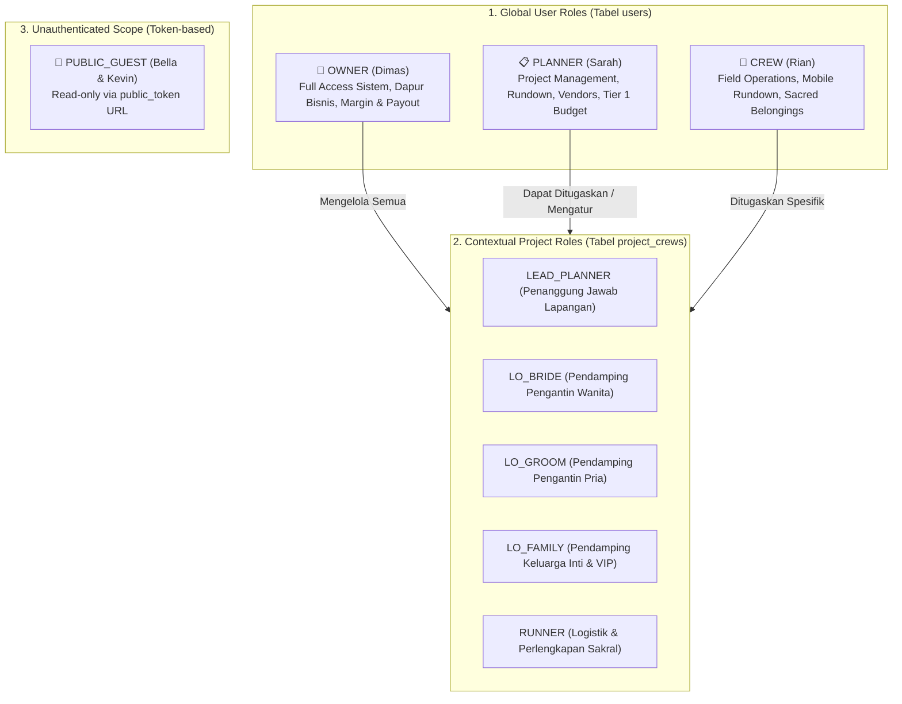
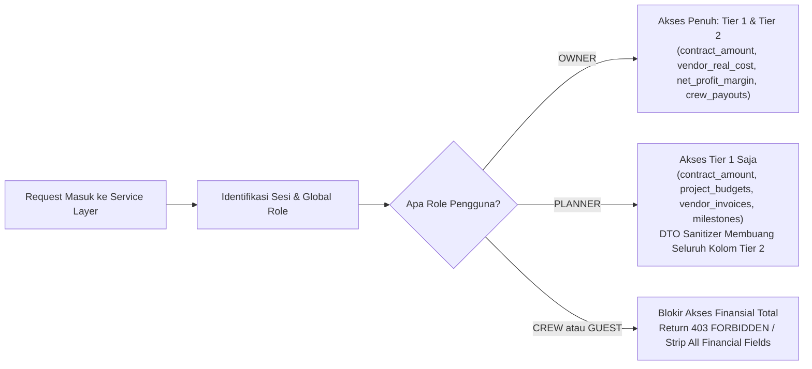

# Kebijakan Keamanan & Kontrol Akses Berbasis Peran (RBAC & Security Specification)
## Single-Tenant Wedding Organizer System

Dokumen ini mendefinisikan arsitektur keamanan, hierarki hak akses (Role-Based Access Control), mekanisme proteksi finansial dua tingkat, serta tata kelola token publik berdasarkan [userpersona.md](file:///D:/PROJECT/WO/userpersona.md), [requirements.md](file:///D:/PROJECT/WO/requirements.md), [architecture.md](file:///D:/PROJECT/WO/architecture.md), [schema.md](file:///D:/PROJECT/WO/schema.md), dan [.agyrules](file:///D:/PROJECT/WO/.agyrules).

---

## 1. Hierarki Peran & Batasan Kontekstual

Sistem menggunakan model otorisasi hibrida: **Global Roles** untuk otorisasi sistem/modul, **Contextual Roles** untuk pembagian tugas operasional hari-H, dan **Unauthenticated Guest Scope** untuk portal klien.



### Rincian Peran:
1. **OWNER (`Dimas`):** Pemegang hak akses tertinggi. Memiliki kewenangan penuh atas data organisasi, seluruh proyek, konfigurasi sistem, dan hak eksklusif terhadap **Tier 2 Keuangan Internal**.
2. **PLANNER (`Sarah`):** Penanggung jawab proyek pernikahan. Berhak membuat dan mengelola data proyek, vendor, rundown, keluarga, dokumen, serta **Tier 1 Bujet Operasional Acara**. Dilarang melihat data Tier 2 (margin kantor & honor kru).
3. **CREW (`Rian`):** Tim operasional hari-H (staf/freelancer). Hanya memiliki akses baca terhadap proyek tempat ia ditugaskan, lembar rundown, kontak darurat, serta izin mutasi status pada checklist barang sakral. Terisolasi total dari seluruh data finansial (Tier 1 & Tier 2).
4. **PUBLIC_GUEST (`Bella & Kevin`):** Klien pengantin tanpa autentikasi login yang mengakses portal via tautan unik (`/portal/[token]`). Hanya dapat membaca informasi ringkasan proyek yang terkurasi.

---

## 2. Matriks Izin Akses CRUD Lengkap

Keterangan:
- **C** = Create, **R** = Read, **U** = Update, **D** = Delete
- **R\*** = Read terbatas (hanya proyek yang ditugaskan kepada user tersebut)
- **R(Curated)** = Read hanya data terkurasi tanpa informasi biaya atau kontak privat
- **-** = Dilarang Keras (Akses Ditolak)

| Entitas Data | OWNER (Dimas) | PLANNER (Sarah) | CREW (Rian) | PUBLIC_GUEST (Klien) |
| :--- | :---: | :---: | :---: | :---: |
| **Users & Akun Internal** | C R U D | R | - | - |
| **Service Packages (Katalog SOW)** | C R U D | R | - | - |
| **Projects (Data Acara)** | C R U D | C R U D | R\* | R(Curated) |
| **Project Crews (Penugasan Tim)** | C R U D | C R U D | R\* | - |
| **Vendors (Master Rekanan)** | C R U D | C R U D | R | - |
| **Project Vendors (Slotting Acara)** | C R U D | C R U D | R\* | R(Nama Saja) |
| **Master Templates & Items** | C R U D | C R U D | R | - |
| **Project Rundowns & Cue Sheet** | C R U D | C R U D | R\* U(Status) | R(Curated) |
| **Wedding Parties (Keluarga & VIP)** | C R U D | C R U D | R\* | - |
| **Sacred Belongings (Logistik Cincin/Mahar)** | C R U D | C R U D | R\* U | - |
| **Project Document Vault** | C R U D | C R U D | R\* | - |
| **Tier 1: Operational Budgets & Invoices** | **C R U D** | **C R U D** | **-** | **-** |
| **Tier 2: Company Finances (Margin Laba)** | **C R U D** | **-** | **-** | **-** |
| **Tier 2: Crew Payouts (Tarif & Honor)** | **C R U D** | **-** | **-** | **-** |

---

## 3. Kebijakan Proteksi Finansial Dua Tingkat (Dual-Tier Financial Guard)

Sistem menerapkan isolasi data finansial yang ketat pada level Service Layer dan Serialisasi DTO sebelum data dikirimkan ke lapisan antarmuka pengguna (UI).



### 3.1 Mekanisme Isolasi Tier 1: Bujet Operasional Acara
- **Entitas:** `projects.contract_amount`, `project_budgets`, `vendor_invoices`, `payment_milestones`.
- **Pengguna Berhak:** `OWNER` dan `PLANNER`.
- **Tujuan:** Sarah memerlukan angka plafon `contract_amount` untuk memecah alokasi anggaran bersama klien serta mencatat jadwal penagihan invoice vendor.

### 3.2 Mekanisme Isolasi Tier 2: Keuangan Internal Dapur Bisnis (Owner-Only)
- **Entitas:** `company_finances` (`gross_contract_price`, `vendor_real_cost`, `crew_total_expense`, `net_profit_margin`), `crew_payouts` (`daily_rate`, `total_payout`).
- **Pengguna Berhak:** **Eksklusif `OWNER` (Dimas)**.
- **Aturan Eksekusi Query:**
  1. Service functions untuk Tier 2 (misal: `getProjectFinancialReport`, `getBatchCrewPayouts`) wajib memanggil guard `assertRole(session, ["OWNER"])`.
  2. DTO Serializer wajib menghapus properti keuangan Tier 2 jika response ditujukan untuk role selain `OWNER`.
  3. Dilarang menggunakan `SELECT *` yang berpotensi membocorkan kolom `company_finances`.

### 3.3 Larangan Total untuk CREW dan PUBLIC_GUEST
- Komponen UI untuk kru lapangan dan portal publik dilarang menerima properti bertipe finansial sama sekali.
- Status invoice vendor hanya diekspos ke kru dalam bentuk status operasional kehadiran vendor (*Hadir / Terkonfirmasi*), bukan status pembayaran atau nilai tagihan.

---

## 4. Keamanan Akses Tamu Publik (Tokenized Magic Link)

### 4.1 Spesifikasi `public_token`
- **Format:** NanoID atau CUID2 (panjang minimal 21-25 karakter alfanumerik acak, non-enumerable, URL-safe).
- **Entropi:** Probabilitas tabrakan mendekati nol ($> 10^{18}$ kombinasi), mencegah serangan *enumeration scanning*.
- **Indeks Database:** Terindeks secara unik B-Tree (`idx_projects_public_token`) untuk pemrosesan query instan tanpa login.

### 4.2 Aturan Pembatasan Data Portal Klien (Data Sanitization)
Endpoint `/portal/[token]` hanya mengembalikan DTO publik (`PublicProjectViewDTO`):
- **Boleh Diekspos:**
  - Nama proyek & nama panggilan pengantin (`client_groom_name`, `client_bride_name`).
  - Tanggal pernikahan & countdown hari-H.
  - Nama venue & alamat.
  - Persentase penyelesaian persiapan checklist.
  - Daftar vendor yang **hanya berstatus resmi** (`BOOKED` atau `SETTLED`), hanya menampilkan nama vendor dan kategori (tanpa nomor kontak personal PIC, tanpa nilai kontrak/tagihan).
- **Dilarang Diekspos:**
  - Seluruh nominal uang (harga paket, bujet, modal vendor, sisa pembayaran).
  - Data kontak internal atau nomor HP kru/vendor.
  - Catatan internal WO (*internal notes*).
  - Draft vendor yang masih tahap `INQUIRY`.

### 4.3 Kebijakan Rate Limiting
- Rute `/portal/:token` dan endpoint API-nya diproteksi dengan limitasi request berbasis IP:
  - Maksimal **60 request per menit per alamat IP**.
  - Jika terjadi percobaan *token brute-force* (lebih dari 10 kali 404 dalam 1 menit), IP diblokir sementara (*throttle*) selama 15 menit.

---

## 5. Pola Implementasi Middleware & Guard Helper (TypeScript Strict)

### 5.1 Definisi Tipe Sesi & Response Standar (`src/types/auth.ts`)

```typescript
import type { ActionResponse } from "./action-response";

export type GlobalRole = "OWNER" | "PLANNER" | "CREW";

export interface UserSession {
  userId: string;
  email: string;
  fullName: string;
  role: GlobalRole;
}
```

### 5.2 Helper Otorisasi Server Actions (`src/lib/auth-guard.ts`)

```typescript
import { db } from "@/db";
import { projectCrews } from "@/db/schema";
import { eq, and } from "drizzle-orm";
import type { UserSession, GlobalRole } from "@/types/auth";
import type { ActionResponse } from "@/types/action-response";

/**
 * Memvalidasi apakah user memiliki salah satu dari role global yang diizinkan.
 */
export function assertRole(
  session: UserSession | null,
  allowedRoles: readonly GlobalRole[]
): ActionResponse<void> {
  if (!session) {
    return {
      success: false,
      error: {
        code: "UNAUTHORIZED",
        message: "Sesi kerja telah berakhir. Silakan masuk kembali ke akun Anda.",
      },
    };
  }

  if (!allowedRoles.includes(session.role)) {
    return {
      success: false,
      error: {
        code: "FORBIDDEN",
        message: "Anda tidak memiliki wewenang untuk mengakses atau memodifikasi data ini.",
      },
    };
  }

  return { success: true, data: undefined };
}

/**
 * Memvalidasi apakah pengguna memiliki hak akses ke proyek tertentu.
 * OWNER & PLANNER memiliki akses ke semua proyek.
 * CREW hanya memiliki akses jika terdaftar dalam project_crews proyek tersebut.
 */
export async function assertProjectAccess(
  session: UserSession | null,
  projectId: string
): Promise<ActionResponse<void>> {
  if (!session) {
    return {
      success: false,
      error: {
        code: "UNAUTHORIZED",
        message: "Sesi kerja telah berakhir. Silakan masuk kembali.",
      },
    };
  }

  // OWNER dan PLANNER memiliki hak akses lintas proyek
  if (session.role === "OWNER" || session.role === "PLANNER") {
    return { success: true, data: undefined };
  }

  // Untuk CREW, cek apakah terdaftar di project_crews
  const assignment = await db.query.projectCrews.findFirst({
    where: and(
      eq(projectCrews.projectId, projectId),
      eq(projectCrews.userId, session.userId)
    ),
    columns: { id: true },
  });

  if (!assignment) {
    return {
      success: false,
      error: {
        code: "FORBIDDEN",
        message: "Anda tidak terdaftar sebagai staf penugasan pada proyek pernikahan ini.",
      },
    };
  }

  return { success: true, data: undefined };
}
```

### 5.3 Contoh Penerapan pada Server Action Finansial (`src/actions/finance-actions.ts`)

```typescript
"use server";

import { assertRole } from "@/lib/auth-guard";
import { getSession } from "@/lib/auth"; // Helper auth session provider
import { getProjectProfitReport } from "@/services/finance-service";
import type { ActionResponse } from "@/types/action-response";
import type { CompanyFinanceSummary } from "@/services/finance-service";

export async function fetchProjectProfitSummaryAction(
  projectId: string
): Promise<ActionResponse<CompanyFinanceSummary>> {
  const session = await getSession();

  // GUARD LEVEL 1: Validasi role wajib OWNER (Dimas)
  const roleCheck = assertRole(session, ["OWNER"]);
  if (!roleCheck.success) {
    return roleCheck;
  }

  // Eksekusi logic query jika lolos verifikasi
  return getProjectProfitReport(projectId);
}
```

---

## 6. Ringkasan Checklist Keamanan Sebelum Deploy

- [ ] Seluruh endpoint Tier 2 (`company_finances`, `crew_payouts`) diproteksi guard `assertRole(session, ['OWNER'])`.
- [ ] Tidak ada klausa `SELECT *` pada query yang melibatkan tabel keuangan.
- [ ] DTO portal tamu pengantin (`PublicProjectViewDTO`) tidak menyertakan kolom harga, modal, atau kontak personal.
- [ ] Rute publik `/portal/[token]` menerapkan pembatasan rate limiting pada middleware reverse-proxy / Edge handler.
- [ ] Sesi login menerapkan cookie beratribut `HttpOnly`, `Secure`, dan `SameSite=Lax`.
