# Skema Basis Data (Database Schema Specification)
## Single-Tenant Architecture - Drizzle ORM & PostgreSQL

Dokumen ini mendefinisikan desain skema basis data relasional untuk sistem internal Wedding Organizer berdasarkan [requirements.md](file:///D:/PROJECT/WO/requirements.md), [.agyrules](file:///D:/PROJECT/WO/.agyrules), dan [architecture.md](file:///D:/PROJECT/WO/architecture.md).

---

## 1. Entity Relationship Diagram (ERD)

```mermaid
erDiagram
    SERVICE_PACKAGES ||--o{ PROJECTS : "categorizes"

    USERS ||--o{ PROJECT_CREWS : "assigned_to"
    USERS ||--o{ SACRED_BELONGINGS : "holds_logistics"
    USERS ||--o{ CREW_PAYOUTS : "receives_payout"

    PROJECTS ||--o{ PROJECT_CREWS : "has_teams"
    PROJECTS ||--o{ PROJECT_VENDORS : "contracts"
    PROJECTS ||--o{ PROJECT_RUNDOWNS : "executes"
    PROJECTS ||--o{ WEDDING_PARTIES : "registers"
    PROJECTS ||--o{ SACRED_BELONGINGS : "tracks_items"
    PROJECTS ||--o{ PROJECT_DOCUMENTS : "stores_vault"
    PROJECTS ||--o{ PROJECT_BUDGETS : "allocates_budget"
    PROJECTS ||--o{ PAYMENT_MILESTONES : "schedules_payments"
    PROJECTS ||--|| COMPANY_FINANCES : "tracks_margin "
    PROJECTS ||--o{ CREW_PAYOUTS : "calculates_payouts"

    VENDORS ||--o{ PROJECT_VENDORS : "participates_in"
    PROJECT_VENDORS ||--o{ VENDOR_INVOICES : "issues_bills"

    EVENT_TEMPLATES ||--o{ TEMPLATE_RUNDOWN_ITEMS : "contains_items"

    SERVICE_PACKAGES {
        uuid id PK
        string package_name
        string package_type "DAY_OF, FULL_PLANNING"
        numeric base_price
        text included_services
        text excluded_services
        boolean is_active
    }

    USERS {
        uuid id PK
        string full_name
        string email UK
        string phone
        string role "OWNER, PLANNER, CREW"
        boolean is_active
        timestamp created_at
    }

    PROJECTS {
        uuid id PK
        uuid package_id FK "Relasi ke service_packages"
        string project_name
        string client_groom_name
        string client_bride_name
        date wedding_date "Indexed"
        string venue_name
        numeric contract_amount "Plafon Bujet Sarah (Tier 1)"
        string public_token UK "Fast Access Bella Kevin"
        string status
    }

    PROJECT_CREWS {
        uuid id PK
        uuid project_id FK
        uuid user_id FK "UK with event_date"
        date event_date "Anti-Bentrok Constraint"
        string role_in_project
        time shift_start
        time shift_end
    }

    VENDORS {
        uuid id PK
        string vendor_name
        string category
        string pic_name
        string phone "wa.me link"
        boolean is_active
    }

    PROJECT_VENDORS {
        uuid id PK
        uuid project_id FK
        uuid vendor_id FK
        string category
        string contract_status "INQUIRY, BOOKED, PAID"
        text notes
    }

    EVENT_TEMPLATES {
        uuid id PK
        string template_name
        string ceremony_type "Sunda, Jawa, Batak, Matrimony"
        text description
    }

    TEMPLATE_RUNDOWN_ITEMS {
        uuid id PK
        uuid template_id FK
        integer order_index
        time start_time
        time end_time
        string title
        string pic_role
    }

    PROJECT_RUNDOWNS {
        uuid id PK
        uuid project_id FK
        integer order_index
        time start_time
        time end_time
        string title
        string pic_role
        string status "PENDING, NOW, DONE"
    }

    WEDDING_PARTIES {
        uuid id PK
        uuid project_id FK
        string name
        string relationship "Ortu, Saksi Nikah, VIP"
        string phone
    }

    SACRED_BELONGINGS {
        uuid id PK
        uuid project_id FK
        string item_name "Cincin, Mahar, Gaun"
        string current_location "Ruang Rias, Meja Akad"
        uuid current_holder_id FK
        string status
    }

    PROJECT_DOCUMENTS {
        uuid id PK
        uuid project_id FK
        string title
        string category "LAYOUT, PERMIT, ELEC"
        string file_url
    }

    PROJECT_BUDGETS {
        uuid id PK
        uuid project_id FK
        string category "Catering, Decor"
        numeric allocated_amount
    }

    VENDOR_INVOICES {
        uuid id PK
        uuid project_vendor_id FK
        string invoice_number
        numeric total_amount
        string status "PENDING, PAID"
    }

    PAYMENT_MILESTONES {
        uuid id PK
        uuid project_id FK
        string title "DP 1, DP 2, Pelunasan"
        numeric amount
        string status "PENDING, PAID"
    }

    COMPANY_FINANCES {
        uuid id PK
        uuid project_id FK "1:1 Unique (Owner Only)"
        numeric gross_contract_price
        numeric net_profit_margin
        numeric vendor_real_cost
        numeric crew_total_expense
    }

    CREW_PAYOUTS {
        uuid id PK
        uuid project_id FK
        uuid user_id FK "Honor Kru (Owner Only)"
        numeric daily_rate
        numeric total_payout
        string payout_status
    }
```



---

## 2. Struktur Skema Berdasarkan Fase & Domain

### A. Core Planning & Operational (Fase 1 - MVP P0)
1. **`users`**: Basis data akun internal kantor dengan peran `OWNER` (Dimas), `PLANNER` (Sarah), dan `CREW` (Rian).
2. **`service_packages`**: Katalog batasan paket (*Day-of* vs *Full Planning*) untuk mencegah *scope creep*, terhubung langsung sebagai FK di `projects`.
3. **`projects`**: Entitas sentral pernikahan. Memuat `contract_amount` sebagai plafon bujet yang bisa dilihat Sarah (Tier 1) dan `public_token` unik untuk portal read-only pengantin (Bella & Kevin).
4. **`project_crews`**: Tabel penugasan tim ke proyek. Memiliki `UNIQUE CONSTRAINT (user_id, event_date)` untuk mencegah bentrok kru.
5. **`vendors`**: Direktori master rekanan WO (MUA, Dekorasi, Katering, Foto, dll.).
6. **`project_vendors`**: Pemetaan rekanan yang dikontrak untuk proyek tertentu beserta statusnya (`INQUIRY`, `BOOKED`, `DP_PAID`, `SETTLED`).
7. **`event_templates` & `template_rundown_items`**: Pustaka template prosesi adat (Jawa, Sunda, Batak) dan agama (Akad, Holy Matrimony).
8. **`project_rundowns`**: Rundown aktif menit-per-menit untuk proyek pengantin lengkap dengan *cue sheet* musik & lighting.
9. **`wedding_parties`**: Direktori keluarga inti, saksi nikah, dan pengiring pengantin.

### B. Field Mobility & Supporting (Fase 2 - P1)
1. **`sacred_belongings`**: Pelacak logistik barang sakral (kotak cincin, mahar, gaun ganti) yang dikawal Rian pada hari-H.
2. **`project_documents`**: Brankas berkas digital (*document vault*) menyimpan layout venue, surat izin KUA/Gereja, dan daya listrik.

### C. Pemisahan Finansial (Dual-Tier Financial Boundary)
1. **Bujet Operasional Acara (Akses: Owner & Planner)**
   - `projects.contract_amount`: Plafon total nilai kontrak acara yang menjadi acuan Sarah & Dimas membagi bujet tanpa membuka margin laba kantor.
   - **`project_budgets`**: Alokasi anggaran per kategori kebutuhan pengantin (Catering, Dekorasi, Venue).
   - **`vendor_invoices`**: Tagihan pembayaran vendor rekanan.
   - **`payment_milestones`**: Jadwal termin pembayaran klien (DP 1, DP 2, Pelunasan).
2. **Keuangan Internal Dapur Bisnis (Akses Eksklusif: Owner Saja)**
   - **`company_finances`**: Tabel 1-to-1 dengan proyek, mencatat omzet bruto, margin laba kotor/bersih, dan total modal vendor riil.
   - **`crew_payouts`**: Rekap kalkulasi honor harian kru lapangan berdasarkan sesi kerja dan pencairan mingguan.

---

## 3. Constraint Kritis Sistem

### 1. Anti-Bentrok Kru Real-time (Database Level)
```sql
ALTER TABLE "project_crews" 
ADD CONSTRAINT "unique_crew_event_date" 
UNIQUE ("user_id", "event_date");
```
* **Fungsi:** Mencegah seorang staf/freelancer dijadwalkan pada dua pernikahan berbeda di tanggal yang sama. Database PostgreSQL akan langsung menolak mutasi (*hard rejection*) jika ada duplikasi penugasan.

### 2. Tokenized Public Access (Client Portal Pengantin)
```sql
CREATE UNIQUE INDEX "idx_projects_public_token" 
ON "projects" ("public_token");
```
* **Fungsi:** Memastikan tautan instan `/portal/[token]` dapat diakses cepat (< 50ms) dengan indeks hash/B-tree tanpa melalui form login.

---

## 4. Definisi Drizzle ORM Schema Lengkap (`src/db/schema/*`)

### `src/db/schema/users.ts`
```typescript
import { pgTable, uuid, text, timestamp, boolean, pgEnum } from "drizzle-orm/pg-core";
import { relations } from "drizzle-orm";
import { projectCrews } from "./project-crews";
import { sacredBelongings } from "./supporting-phase2";
import { crewPayouts } from "./company-finances";

export const userRoleEnum = pgEnum("user_role", ["OWNER", "PLANNER", "CREW"]);

export const users = pgTable("users", {
  id: uuid("id").defaultRandom().primaryKey(),
  fullName: text("full_name").notNull(),
  email: text("email").notNull().unique(),
  phone: text("phone").notNull(),
  passwordHash: text("password_hash").notNull(),
  role: userRoleEnum("role").notNull().default("CREW"),
  isActive: boolean("is_active").notNull().default(true),
  createdAt: timestamp("created_at", { withTimezone: true }).defaultNow().notNull(),
  updatedAt: timestamp("updated_at", { withTimezone: true }).defaultNow().notNull(),
});

export const usersRelations = relations(users, ({ many }) => ({
  projectAssignments: many(projectCrews),
  heldLogistics: many(sacredBelongings),
  payouts: many(crewPayouts),
}));
```

### `src/db/schema/supporting-phase2.ts`
```typescript
import { pgTable, uuid, text, boolean, numeric, timestamp, pgEnum } from "drizzle-orm/pg-core";
import { relations } from "drizzle-orm";
import { projects } from "./projects";
import { users } from "./users";

export const logisticsStatusEnum = pgEnum("logistics_status", [
  "NOT_RECEIVED",
  "WITH_CREW",
  "AT_STAGE",
  "RETURNED_TO_FAMILY",
]);

export const servicePackages = pgTable("service_packages", {
  id: uuid("id").defaultRandom().primaryKey(),
  packageName: text("package_name").notNull(),
  packageType: text("package_type").notNull(), // "DAY_OF_COORDINATION", "FULL_PLANNING"
  basePrice: numeric("base_price", { precision: 12, scale: 2 }).notNull(),
  includedServices: text("included_services").notNull(), // JSON / teks deskripsi
  excludedServices: text("excluded_services").notNull(), // Batasan anti scope-creep
  isActive: boolean("is_active").notNull().default(true),
  createdAt: timestamp("created_at", { withTimezone: true }).defaultNow().notNull(),
});

export const servicePackagesRelations = relations(servicePackages, ({ many }) => ({
  projects: many(projects),
}));

export const sacredBelongings = pgTable("sacred_belongings", {
  id: uuid("id").defaultRandom().primaryKey(),
  projectId: uuid("project_id").notNull().references(() => projects.id, { onDelete: "cascade" }),
  itemName: text("item_name").notNull(), // "KOTAK_CINCIN", "BUKU_NIKAH", "MAHAR"
  currentLocation: text("current_location").notNull(), // "KAMAR_HOTEL_802", "MEJA_AKAD"
  currentHolderId: uuid("current_holder_id").references(() => users.id, { onDelete: "set null" }),
  status: logisticsStatusEnum("status").notNull().default("NOT_RECEIVED"),
  notes: text("notes"),
  updatedAt: timestamp("updated_at", { withTimezone: true }).defaultNow().notNull(),
});

export const sacredBelongingsRelations = relations(sacredBelongings, ({ one }) => ({
  project: one(projects, { fields: [sacredBelongings.projectId], references: [projects.id] }),
  holder: one(users, { fields: [sacredBelongings.currentHolderId], references: [users.id] }),
}));

export const projectDocuments = pgTable("project_documents", {
  id: uuid("id").defaultRandom().primaryKey(),
  projectId: uuid("project_id").notNull().references(() => projects.id, { onDelete: "cascade" }),
  title: text("title").notNull(),
  category: text("category").notNull(), // "LAYOUT_VENUE", "ELECTRICITY_SPEC", "PERMIT"
  fileUrl: text("file_url").notNull(),
  fileType: text("file_type").notNull(),
  fileSize: numeric("file_size"),
  uploadedBy: uuid("uploaded_by").references(() => users.id, { onDelete: "set null" }),
  createdAt: timestamp("created_at", { withTimezone: true }).defaultNow().notNull(),
});

export const projectDocumentsRelations = relations(projectDocuments, ({ one }) => ({
  project: one(projects, { fields: [projectDocuments.projectId], references: [projects.id] }),
  uploader: one(users, { fields: [projectDocuments.uploadedBy], references: [users.id] }),
}));
```

### `src/db/schema/projects.ts`
```typescript
import { pgTable, uuid, text, date, numeric, timestamp, pgEnum, uniqueIndex } from "drizzle-orm/pg-core";
import { relations } from "drizzle-orm";
import { servicePackages } from "./supporting-phase2";
import { projectCrews } from "./project-crews";
import { projectVendors } from "./vendors";
import { projectRundowns } from "./rundowns";
import { weddingParties } from "./wedding-parties";
import { sacredBelongings, projectDocuments } from "./supporting-phase2";
import { projectBudgets, paymentMilestones } from "./operational-budgets";
import { companyFinances, crewPayouts } from "./company-finances";

export const projectStatusEnum = pgEnum("project_status", [
  "LEAD",
  "PLANNING",
  "READY",
  "IN_PROGRESS",
  "COMPLETED",
  "CANCELLED",
]);

export const projects = pgTable(
  "projects",
  {
    id: uuid("id").defaultRandom().primaryKey(),
    packageId: uuid("package_id").references(() => servicePackages.id, { onDelete: "set null" }),
    projectName: text("project_name").notNull(),
    clientGroomName: text("client_groom_name").notNull(),
    clientBrideName: text("client_bride_name").notNull(),
    weddingDate: date("wedding_date").notNull(),
    venueName: text("venue_name").notNull(),
    venueAddress: text("venue_address"),
    
    // Plafon Anggaran Operasional (Tier 1: Terbuka untuk Sarah & Dimas)
    contractAmount: numeric("contract_amount", { precision: 12, scale: 2 }).notNull().default("0"),
    
    // Tautan publik instan tanpa login (Bella & Kevin)
    publicToken: text("public_token").notNull().unique(),
    status: projectStatusEnum("status").notNull().default("PLANNING"),
    createdAt: timestamp("created_at", { withTimezone: true }).defaultNow().notNull(),
    updatedAt: timestamp("updated_at", { withTimezone: true }).defaultNow().notNull(),
  },
  (table) => ({
    publicTokenIdx: uniqueIndex("idx_projects_public_token").on(table.publicToken),
    weddingDateIdx: uniqueIndex("idx_projects_wedding_date").on(table.weddingDate, table.id),
  })
);

export const projectsRelations = relations(projects, ({ one, many }) => ({
  package: one(servicePackages, { fields: [projects.packageId], references: [servicePackages.id] }),
  crews: many(projectCrews),
  vendors: many(projectVendors),
  rundowns: many(projectRundowns),
  weddingParties: many(weddingParties),
  sacredBelongings: many(sacredBelongings),
  documents: many(projectDocuments),
  budgets: many(projectBudgets),
  milestones: many(paymentMilestones),
  companyFinance: one(companyFinances, {
    fields: [projects.id],
    references: [companyFinances.projectId],
  }),
  crewPayouts: many(crewPayouts),
}));
```

### `src/db/schema/project-crews.ts`
```typescript
import { pgTable, uuid, date, time, text, timestamp, unique } from "drizzle-orm/pg-core";
import { relations } from "drizzle-orm";
import { users } from "./users";
import { projects } from "./projects";

export const projectCrews = pgTable(
  "project_crews",
  {
    id: uuid("id").defaultRandom().primaryKey(),
    projectId: uuid("project_id").notNull().references(() => projects.id, { onDelete: "cascade" }),
    userId: uuid("user_id").notNull().references(() => users.id, { onDelete: "restrict" }),
    eventDate: date("event_date").notNull(),
    roleInProject: text("role_in_project").notNull(), // e.g. "LEAD_PLANNER", "LO_BRIDE", "RUNNER"
    shiftStart: time("shift_start"),
    shiftEnd: time("shift_end"),
    createdAt: timestamp("created_at", { withTimezone: true }).defaultNow().notNull(),
  },
  (table) => ({
    // CONSTRAINT KRITIS ANTI-BENTROK: 1 kru hanya boleh di 1 tanggal acara
    antiConflictSchedule: unique("unique_crew_event_date").on(table.userId, table.eventDate),
  })
);

export const projectCrewsRelations = relations(projectCrews, ({ one }) => ({
  project: one(projects, { fields: [projectCrews.projectId], references: [projects.id] }),
  user: one(users, { fields: [projectCrews.userId], references: [users.id] }),
}));
```

### `src/db/schema/vendors.ts`
```typescript
import { pgTable, uuid, text, boolean, timestamp, pgEnum } from "drizzle-orm/pg-core";
import { relations } from "drizzle-orm";
import { projects } from "./projects";
import { vendorInvoices } from "./operational-budgets";

export const vendorCategoryEnum = pgEnum("vendor_category", [
  "MUA",
  "DECORATION",
  "CATERING",
  "PHOTO_VIDEO",
  "SOUND_LIGHTING",
  "VENUE",
  "MC",
  "ATTIRE",
  "ENTERTAINMENT",
  "OTHER",
]);

export const contractStatusEnum = pgEnum("contract_status", [
  "INQUIRY",
  "BOOKED",
  "DP_PAID",
  "SETTLED",
  "CANCELLED",
]);

export const vendors = pgTable("vendors", {
  id: uuid("id").defaultRandom().primaryKey(),
  vendorName: text("vendor_name").notNull(),
  category: vendorCategoryEnum("category").notNull(),
  picName: text("pic_name").notNull(),
  phone: text("phone").notNull(),
  email: text("email"),
  address: text("address"),
  isActive: boolean("is_active").notNull().default(true),
  createdAt: timestamp("created_at", { withTimezone: true }).defaultNow().notNull(),
  updatedAt: timestamp("updated_at", { withTimezone: true }).defaultNow().notNull(),
});

export const projectVendors = pgTable("project_vendors", {
  id: uuid("id").defaultRandom().primaryKey(),
  projectId: uuid("project_id").notNull().references(() => projects.id, { onDelete: "cascade" }),
  vendorId: uuid("vendor_id").notNull().references(() => vendors.id, { onDelete: "restrict" }),
  category: vendorCategoryEnum("category").notNull(),
  contractStatus: contractStatusEnum("contract_status").notNull().default("INQUIRY"),
  notes: text("notes"),
  createdAt: timestamp("created_at", { withTimezone: true }).defaultNow().notNull(),
  updatedAt: timestamp("updated_at", { withTimezone: true }).defaultNow().notNull(),
});

export const vendorsRelations = relations(vendors, ({ many }) => ({
  projectAssignments: many(projectVendors),
}));

export const projectVendorsRelations = relations(projectVendors, ({ one, many }) => ({
  project: one(projects, { fields: [projectVendors.projectId], references: [projects.id] }),
  vendor: one(vendors, { fields: [projectVendors.vendorId], references: [vendors.id] }),
  invoices: many(vendorInvoices),
}));
```

### `src/db/schema/rundowns.ts`
```typescript
import { pgTable, uuid, text, time, integer, timestamp, pgEnum } from "drizzle-orm/pg-core";
import { relations } from "drizzle-orm";
import { projects } from "./projects";

export const rundownStatusEnum = pgEnum("rundown_status", [
  "PENDING",
  "IN_PROGRESS",
  "COMPLETED",
  "DELAYED",
]);

export const eventTemplates = pgTable("event_templates", {
  id: uuid("id").defaultRandom().primaryKey(),
  templateName: text("template_name").notNull(),
  ceremonyType: text("ceremony_type").notNull(), // e.g. "ADAT_SUNDA", "HOLY_MATRIMONY"
  description: text("description"),
  createdAt: timestamp("created_at", { withTimezone: true }).defaultNow().notNull(),
  updatedAt: timestamp("updated_at", { withTimezone: true }).defaultNow().notNull(),
});

export const templateRundownItems = pgTable("template_rundown_items", {
  id: uuid("id").defaultRandom().primaryKey(),
  templateId: uuid("template_id").notNull().references(() => eventTemplates.id, { onDelete: "cascade" }),
  orderIndex: integer("order_index").notNull(),
  startTime: time("start_time").notNull(),
  endTime: time("end_time").notNull(),
  title: text("title").notNull(),
  description: text("description"),
  picRole: text("pic_role"),
  musicCue: text("music_cue"),
  lightingCue: text("lighting_cue"),
});

export const projectRundowns = pgTable("project_rundowns", {
  id: uuid("id").defaultRandom().primaryKey(),
  projectId: uuid("project_id").notNull().references(() => projects.id, { onDelete: "cascade" }),
  orderIndex: integer("order_index").notNull(),
  startTime: time("start_time").notNull(),
  endTime: time("end_time").notNull(),
  title: text("title").notNull(),
  description: text("description"),
  picRole: text("pic_role"),
  musicCue: text("music_cue"),
  lightingCue: text("lighting_cue"),
  status: rundownStatusEnum("status").notNull().default("PENDING"),
  createdAt: timestamp("created_at", { withTimezone: true }).defaultNow().notNull(),
  updatedAt: timestamp("updated_at", { withTimezone: true }).defaultNow().notNull(),
});

export const eventTemplatesRelations = relations(eventTemplates, ({ many }) => ({
  items: many(templateRundownItems),
}));

export const projectRundownsRelations = relations(projectRundowns, ({ one }) => ({
  project: one(projects, { fields: [projectRundowns.projectId], references: [projects.id] }),
}));
```

### `src/db/schema/wedding-parties.ts`
```typescript
import { pgTable, uuid, text, timestamp } from "drizzle-orm/pg-core";
import { relations } from "drizzle-orm";
import { projects } from "./projects";

export const weddingParties = pgTable("wedding_parties", {
  id: uuid("id").defaultRandom().primaryKey(),
  projectId: uuid("project_id").notNull().references(() => projects.id, { onDelete: "cascade" }),
  name: text("name").notNull(),
  relationship: text("relationship").notNull(), // e.g. "AYAH_PENGANTIN_WANITA", "SAKSI_NIKAH"
  phone: text("phone"),
  ceremonialRole: text("ceremonial_role"),
  notes: text("notes"),
  createdAt: timestamp("created_at", { withTimezone: true }).defaultNow().notNull(),
});

export const weddingPartiesRelations = relations(weddingParties, ({ one }) => ({
  project: one(projects, { fields: [weddingParties.projectId], references: [projects.id] }),
}));
```

### `src/db/schema/operational-budgets.ts` (Tier 1: Owner & Planner)
```typescript
import { pgTable, uuid, text, numeric, date, timestamp, pgEnum } from "drizzle-orm/pg-core";
import { relations } from "drizzle-orm";
import { projects } from "./projects";
import { projectVendors } from "./vendors";

export const paymentStatusEnum = pgEnum("payment_status", [
  "PENDING",
  "PARTIALLY_PAID",
  "PAID",
  "OVERDUE",
]);

export const projectBudgets = pgTable("project_budgets", {
  id: uuid("id").defaultRandom().primaryKey(),
  projectId: uuid("project_id").notNull().references(() => projects.id, { onDelete: "cascade" }),
  category: text("category").notNull(), // "VENUE", "CATERING", "DECOR"
  allocatedAmount: numeric("allocated_amount", { precision: 12, scale: 2 }).notNull(),
  notes: text("notes"),
  createdAt: timestamp("created_at", { withTimezone: true }).defaultNow().notNull(),
  updatedAt: timestamp("updated_at", { withTimezone: true }).defaultNow().notNull(),
});

export const vendorInvoices = pgTable("vendor_invoices", {
  id: uuid("id").defaultRandom().primaryKey(),
  projectVendorId: uuid("project_vendor_id").notNull().references(() => projectVendors.id, { onDelete: "cascade" }),
  invoiceNumber: text("invoice_number").notNull(),
  totalAmount: numeric("total_amount", { precision: 12, scale: 2 }).notNull(),
  dueDate: date("due_date").notNull(),
  status: paymentStatusEnum("status").notNull().default("PENDING"),
  invoiceFileUrl: text("invoice_file_url"),
  createdAt: timestamp("created_at", { withTimezone: true }).defaultNow().notNull(),
  updatedAt: timestamp("updated_at", { withTimezone: true }).defaultNow().notNull(),
});

export const paymentMilestones = pgTable("payment_milestones", {
  id: uuid("id").defaultRandom().primaryKey(),
  projectId: uuid("project_id").notNull().references(() => projects.id, { onDelete: "cascade" }),
  title: text("title").notNull(), // "DP 1 (Booking)", "DP 2", "Pelunasan"
  amount: numeric("amount", { precision: 12, scale: 2 }).notNull(),
  dueDate: date("due_date").notNull(),
  paidDate: date("paid_date"),
  status: paymentStatusEnum("status").notNull().default("PENDING"),
  proofFileUrl: text("proof_file_url"),
  createdAt: timestamp("created_at", { withTimezone: true }).defaultNow().notNull(),
});

export const operationalBudgetsRelations = relations(projectBudgets, ({ one }) => ({
  project: one(projects, { fields: [projectBudgets.projectId], references: [projects.id] }),
}));

export const vendorInvoicesRelations = relations(vendorInvoices, ({ one }) => ({
  projectVendor: one(projectVendors, { fields: [vendorInvoices.projectVendorId], references: [projectVendors.id] }),
}));

export const paymentMilestonesRelations = relations(paymentMilestones, ({ one }) => ({
  project: one(projects, { fields: [paymentMilestones.projectId], references: [projects.id] }),
}));
```

### `src/db/schema/company-finances.ts` (Tier 2: Eksklusif Owner Saja)
```typescript
import { pgTable, uuid, numeric, text, timestamp, pgEnum, uniqueIndex } from "drizzle-orm/pg-core";
import { relations } from "drizzle-orm";
import { projects } from "./projects";
import { users } from "./users";

export const payoutStatusEnum = pgEnum("payout_status", ["PENDING", "PAID"]);

// Dapur Bisnis: 1-to-1 dengan Projects (Hanya Dimas yang berhak query tabel ini)
export const companyFinances = pgTable(
  "company_finances",
  {
    id: uuid("id").defaultRandom().primaryKey(),
    projectId: uuid("project_id").notNull().unique().references(() => projects.id, { onDelete: "cascade" }),
    grossContractPrice: numeric("gross_contract_price", { precision: 12, scale: 2 }).notNull(),
    vendorRealCost: numeric("vendor_real_cost", { precision: 12, scale: 2 }).notNull().default("0"),
    crewTotalExpense: numeric("crew_total_expense", { precision: 12, scale: 2 }).notNull().default("0"),
    netProfitMargin: numeric("net_profit_margin", { precision: 12, scale: 2 }).notNull().default("0"),
    notes: text("notes"),
    createdAt: timestamp("created_at", { withTimezone: true }).defaultNow().notNull(),
    updatedAt: timestamp("updated_at", { withTimezone: true }).defaultNow().notNull(),
  },
  (table) => ({
    projectFinanceIdx: uniqueIndex("idx_company_finances_project_id").on(table.projectId),
  })
);

// Kalkulator & Rekapitulasi Honor Harian Kru (Owner-Only)
export const crewPayouts = pgTable("crew_payouts", {
  id: uuid("id").defaultRandom().primaryKey(),
  projectId: uuid("project_id").notNull().references(() => projects.id, { onDelete: "cascade" }),
  userId: uuid("user_id").notNull().references(() => users.id, { onDelete: "restrict" }),
  dailyRate: numeric("daily_rate", { precision: 10, scale: 2 }).notNull(),
  sessionCount: numeric("session_count", { precision: 4, scale: 1 }).notNull().default("1.0"),
  totalPayout: numeric("total_payout", { precision: 10, scale: 2 }).notNull(),
  payoutStatus: payoutStatusEnum("payout_status").notNull().default("PENDING"),
  paidAt: timestamp("paid_at", { withTimezone: true }),
  notes: text("notes"),
  createdAt: timestamp("created_at", { withTimezone: true }).defaultNow().notNull(),
});

export const companyFinancesRelations = relations(companyFinances, ({ one }) => ({
  project: one(projects, { fields: [companyFinances.projectId], references: [projects.id] }),
}));

export const crewPayoutsRelations = relations(crewPayouts, ({ one }) => ({
  project: one(projects, { fields: [crewPayouts.projectId], references: [projects.id] }),
  crew: one(users, { fields: [crewPayouts.userId], references: [users.id] }),
}));
```
