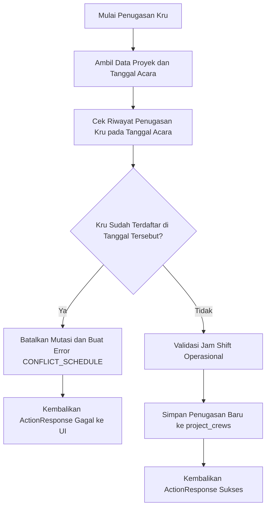
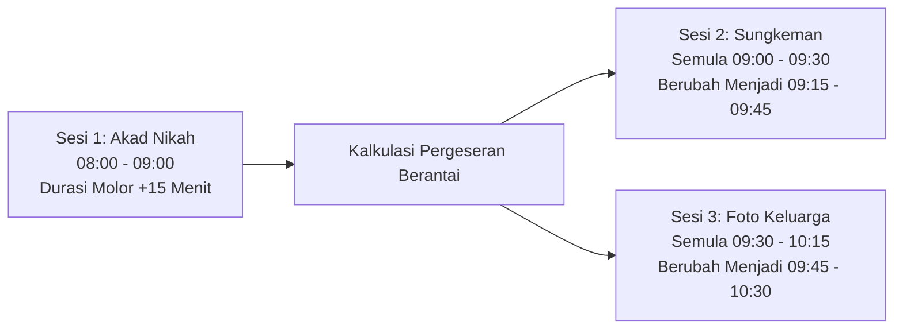
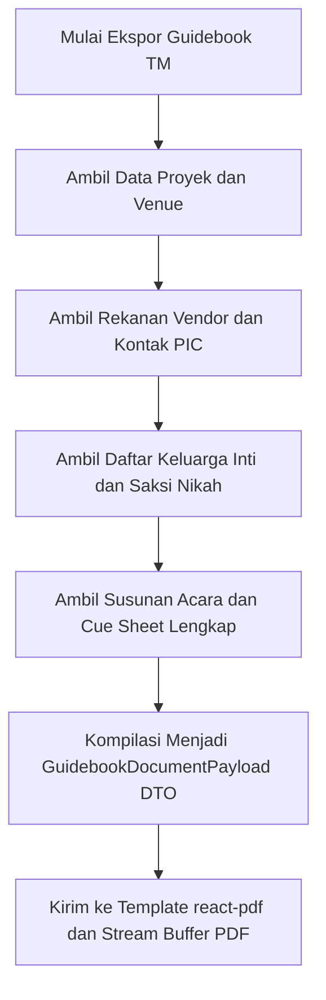

# Alur Kerja & Spesifikasi Logika Bisnis (Workflows Specification)
## Single-Tenant Wedding Organizer System - Service Layer & Business Logic

Dokumen ini mendefinisikan algoritma komputasi, alur mutasi data, dan logika validasi yang dieksekusi pada Service Layer (`src/services/*`) dan Server Actions (`src/actions/*`) berdasarkan [requirements.md](file:///D:/PROJECT/WO/requirements.md), [.agyrules](file:///D:/PROJECT/WO/.agyrules), [architecture.md](file:///D:/PROJECT/WO/architecture.md), dan [schema.md](file:///D:/PROJECT/WO/schema.md).

---

## 1. Mesin Validasi Anti-Bentrok Kru (Anti-Collision Engine)

### 1.1 Deskripsi Alur
Mencegah seorang kru atau staf internal/freelancer ditugaskan pada dua acara pernikahan berbeda pada tanggal yang sama (`event_date`). Validasi berjalan dua lapis:
1. **Application Layer (Service Check):** Pemeriksaan preventif di database sebelum query mutasi, mengembalikan error `ActionResponse` ramah pengguna.
2. **Database Layer (Constraint Fallback):** Menjamin integritas transaksional via `UNIQUE("user_id", "event_date")` pada tabel `project_crews`.

### 1.2 Flowchart Validasi



### 1.3 Implementasi TypeScript Strict (`src/services/crew-service.ts`)

```typescript
import { db } from "@/db";
import { projectCrews, projects, users } from "@/db/schema";
import { eq, and } from "drizzle-orm";
import type { ActionResponse } from "@/types/action-response";

export interface AssignCrewInput {
  projectId: string;
  userId: string;
  roleInProject: string;
  shiftStart?: string;
  shiftEnd?: string;
}

export interface CrewAssignmentResult {
  assignmentId: string;
  projectId: string;
  userId: string;
  eventDate: string;
  roleInProject: string;
}

export async function assignCrewToProject(
  input: AssignCrewInput
): Promise<ActionResponse<CrewAssignmentResult>> {
  // 1. Ambil data tanggal proyek target
  const project = await db.query.projects.findFirst({
    where: eq(projects.id, input.projectId),
    columns: { id: true, weddingDate: true, projectName: true },
  });

  if (!project) {
    return {
      success: false,
      error: {
        code: "NOT_FOUND",
        message: "Data proyek pernikahan tidak ditemukan.",
      },
    };
  }

  // 2. Cek apakah kru sudah ditugaskan pada event_date yang sama di proyek lain
  const existingAssignment = await db.query.projectCrews.findFirst({
    where: and(
      eq(projectCrews.userId, input.userId),
      eq(projectCrews.eventDate, project.weddingDate)
    ),
    with: {
      project: {
        columns: { projectName: true },
      },
      user: {
        columns: { fullName: true },
      },
    },
  });

  if (existingAssignment) {
    const crewName = existingAssignment.user?.fullName ?? "Kru";
    const conflictProject = existingAssignment.project?.projectName ?? "proyek lain";
    
    return {
      success: false,
      error: {
        code: "CONFLICT_SCHEDULE",
        message: `${crewName} sudah terjadwal bertugas di ${conflictProject} pada tanggal ${project.weddingDate}.`,
        details: {
          conflictingProjectId: existingAssignment.projectId,
          eventDate: project.weddingDate,
        },
      },
    };
  }

  // 3. Eksekusi penyimpanan penugasan
  const [newAssignment] = await db
    .insert(projectCrews)
    .values({
      projectId: input.projectId,
      userId: input.userId,
      eventDate: project.weddingDate,
      roleInProject: input.roleInProject,
      shiftStart: input.shiftStart ?? null,
      shiftEnd: input.shiftEnd ?? null,
    })
    .returning();

  return {
    success: true,
    data: {
      assignmentId: newAssignment.id,
      projectId: newAssignment.projectId,
      userId: newAssignment.userId,
      eventDate: newAssignment.eventDate,
      roleInProject: newAssignment.roleInProject,
    },
  };
}
```

---

## 2. Generator Hitung Mundur Linimasa (Reverse Timeline Engine)

### 2.1 Formula & Logika
Jadwal persiapan dihitung secara mundur dari tanggal Hari-H pernikahan (`wedding_date`).
$$\text{target\_date} = \text{wedding\_date} - \text{offset\_days}$$

### 2.2 Template Milestone Standar & Transisi Status
Status checklist mengalami transisi otomatis berdasarkan perbandingan waktu server saat ini (`now`) terhadap `target_date`:
- `PENDING`: Tanggal saat ini masih jauh sebelum `target_date`.
- `IN_PROGRESS`: Berada dalam rentang 7 hari menjelang `target_date` atau sedang dikerjakan.
- `OVERDUE`: Tanggal saat ini melewati `target_date` dan tugas belum ditandai selesai (`completed_at === null`).
- `COMPLETED`: Tugas telah divalidasi tuntas oleh Sarah atau Pengantin.

| Milestone Induk | Offset Hari | Formula Target | Deskripsi Kegiatan |
| :--- | :--- | :--- | :--- |
| **Pemesanan Venue & DP Vendor Utama** | H-180 hari | `wedding_date - 180` | Kunci tanggal gedung, MUA, dan fotografer. |
| **Food Tasting Katering & Konsep Dekorasi** | H-90 hari | `wedding_date - 90` | Uji rasa menu dan approval sketsa 3D dekorasi. |
| **Fitting Busana Pengantin & Keluarga** | H-45 hari | `wedding_date - 45` | Pengukuran final baju akad dan resepsi. |
| **Penyusunan Draf Kasar Rundown** | H-30 hari | `wedding_date - 30` | Pemetaan susunan prosesi adat dan daftar lagu. |
| **Technical Meeting (TM) Seluruh Vendor** | H-14 hari | `wedding_date - 14` | Koordinasi teknis lapangan, gladi denah, dan daya listrik. |
| **Final Briefing Keluarga & Serah Terima Barang** | H-3 hari | `wedding_date - 3` | Pengecekan kotak cincin, mahar, dan kontak saksi nikah. |

### 2.3 Implementasi TypeScript Strict (`src/services/timeline-service.ts`)

```typescript
import { addDays, subDays, isBefore, isAfter, startOfDay } from "date-fns";

export type TimelineStatus = "PENDING" | "IN_PROGRESS" | "OVERDUE" | "COMPLETED";

export interface TimelineMilestoneConfig {
  taskName: string;
  offsetDays: number;
  category: "VENUE" | "VENDOR" | "RUNDOWN" | "LOGISTICS";
}

export interface ComputedTimelineItem {
  taskName: string;
  category: string;
  targetDate: string; // Format YYYY-MM-DD
  status: TimelineStatus;
}

export function computeReverseTimeline(
  weddingDateStr: string,
  configs: readonly TimelineMilestoneConfig[],
  completedTaskIds: ReadonlySet<string>
): ComputedTimelineItem[] {
  const weddingDate = startOfDay(new Date(weddingDateStr));
  const today = startOfDay(new Date());

  return configs.map((cfg) => {
    const targetDate = subDays(weddingDate, cfg.offsetDays);
    const isCompleted = completedTaskIds.has(cfg.taskName);

    let status: TimelineStatus = "PENDING";

    if (isCompleted) {
      status = "COMPLETED";
    } else if (isBefore(targetDate, today)) {
      status = "OVERDUE";
    } else if (isBefore(today, targetDate) && isAfter(today, subDays(targetDate, 7))) {
      status = "IN_PROGRESS";
    }

    return {
      taskName: cfg.taskName,
      category: cfg.category,
      targetDate: targetDate.toISOString().split("T")[0]!,
      status,
    };
  });
}
```

---

## 3. Re-indexing Rundown & Propagasi Waktu (Time Propagation)

### 3.1 Deskripsi Alur
Rundown hari-H bersifat dinamis:
1. **Re-ordering (Drag and Drop):** Menata ulang urutan susunan acara dan memperbarui `order_index` berurutan (0, 1, 2, ...).
2. **Time Propagation (Pergeseran Berantai):** Jika sesi akad atau resepsi mengalami perubahan durasi (misalnya molor 15 menit), sistem secara otomatis mengkalkulasi ulang `start_time` dan `end_time` seluruh sesi berikutnya secara berantai tanpa tumpang tindih.

### 3.2 Diagram Propagasi Waktu



### 3.3 Implementasi TypeScript Strict (`src/services/rundown-service.ts`)

```typescript
export interface RundownItemModel {
  id: string;
  orderIndex: number;
  startTime: string; // Format "HH:mm"
  endTime: string;   // Format "HH:mm"
  title: string;
  durationMinutes: number;
}

function parseTimeToMinutes(timeStr: string): number {
  const [hours, minutes] = timeStr.split(":").map(Number);
  return (hours ?? 0) * 60 + (minutes ?? 0);
}

function formatMinutesToTime(totalMinutes: number): string {
  const normalized = totalMinutes % (24 * 60);
  const hours = Math.floor(normalized / 60);
  const minutes = normalized % 60;
  return `${String(hours).padStart(2, "0")}:${String(minutes).padStart(2, "0")}`;
}

export function propagateRundownTimes(
  items: readonly RundownItemModel[],
  initialStartTime: string
): RundownItemModel[] {
  let currentStartMinutes = parseTimeToMinutes(initialStartTime);

  // Urutkan item berdasarkan orderIndex
  const sorted = [...items].sort((a, b) => a.orderIndex - b.orderIndex);

  return sorted.map((item, index) => {
    const startStr = formatMinutesToTime(currentStartMinutes);
    const endMinutes = currentStartMinutes + item.durationMinutes;
    const endStr = formatMinutesToTime(endMinutes);

    // Siapkan waktu mulai untuk item sesi berikutnya
    currentStartMinutes = endMinutes;

    return {
      ...item,
      orderIndex: index,
      startTime: startStr,
      endTime: endStr,
    };
  });
}
```

---

## 4. Logika Finansial Dua Tingkat (Dual-Tier Financial Logic)

### 4.1 Alur Kerja Sarah: Bujet Operasional Acara (Tier 1)
- **Validasi Plafon Kontrak:** Total alokasi anggaran pada `project_budgets` tidak boleh melampaui `projects.contract_amount`.
- **Pelacakan Invoice Vendor:** Memantau termin pembayaran vendor rekanan (`UNPAID`, `PARTIALLY_PAID`, `PAID`).
- **Milestone Pengantin:** Memvalidasi status DP 1, DP 2, dan Pelunasan klien.

### 4.2 Alur Kerja Dimas: Dapur Bisnis & Honor Kru (Tier 2 - Owner Only)
- **Kalkulasi Laba Kotor & Margin:**
  $$\text{gross\_profit} = \text{gross\_contract\_price} - \text{vendor\_real\_cost} - \text{crew\_total\_expense}$$
  $$\text{net\_profit\_margin} = \left(\frac{\text{gross\_profit}}{\text{gross\_contract\_price}}\right) \times 100\%$$
- **Kalkulasi Batch Payout Honor Kru:**
  $$\text{total\_payout} = \text{session\_count} \times \text{daily\_rate}$$

### 4.3 Implementasi TypeScript Strict (`src/services/finance-service.ts`)

```typescript
import type { ActionResponse } from "@/types/action-response";

export interface CompanyFinanceSummary {
  projectId: string;
  grossContractPrice: number;
  vendorRealCost: number;
  crewTotalExpense: number;
  grossProfit: number;
  netProfitMarginPercent: number;
}

export function calculateProjectProfit(
  grossContractPrice: number,
  vendorRealCost: number,
  crewTotalExpense: number
): { grossProfit: number; marginPercent: number } {
  const grossProfit = grossContractPrice - vendorRealCost - crewTotalExpense;
  const marginPercent = grossContractPrice > 0 
    ? Number(((grossProfit / grossContractPrice) * 100).toFixed(2))
    : 0;

  return { grossProfit, marginPercent };
}

export interface CrewPayoutItem {
  userId: string;
  dailyRate: number;
  sessionCount: number;
}

export function computeBatchCrewPayouts(
  crews: readonly CrewPayoutItem[]
): { totalExpense: number; payouts: Array<{ userId: string; totalAmount: number }> } {
  let totalExpense = 0;

  const payouts = crews.map((crew) => {
    const totalAmount = crew.dailyRate * crew.sessionCount;
    totalExpense += totalAmount;
    return {
      userId: crew.userId,
      totalAmount,
    };
  });

  return { totalExpense, payouts };
}
```

---

## 5. Generator Pintas WhatsApp (wa.me Engine)

### 5.1 Sanitasi Format Nomor Telepon Indonesia
Menstandarkan format input nomor handphone pengguna lokal:
- Mengubah awalan `08...` atau `+628...` menjadi format internasional murni tanpa simbol: `628...`.
- Menghapus karakter spasi, strip (`-`), dan tanda kurung.

### 5.2 Template Pesan & URL Encoding (`encodeURIComponent`)

### 5.3 Implementasi TypeScript Strict (`src/lib/whatsapp.ts`)

```typescript
export function sanitizeIndonesianPhone(phoneInput: string): string {
  // Hapus semua karakter non-digit
  let cleaned = phoneInput.replace(/\D/g, "");

  if (cleaned.startsWith("0")) {
    cleaned = "62" + cleaned.substring(1);
  } else if (cleaned.startsWith("62")) {
    // Sudah dalam format benar
  } else if (cleaned.startsWith("8")) {
    cleaned = "62" + cleaned;
  }

  return cleaned;
}

export interface TechnicalMeetingDraft {
  vendorPicName: string;
  vendorName: string;
  clientNames: string;
  meetingDate: string;
  meetingTime: string;
  venueName: string;
  rawPhone: string;
}

export function generateVendorTmWhatsappUrl(data: TechnicalMeetingDraft): string {
  const phone = sanitizeIndonesianPhone(data.rawPhone);

  const messageText = 
`Halo Kak ${data.vendorPicName} (${data.vendorName}),
Kami dari tim Wedding Organizer ${data.clientNames}.

Berikut adalah undangan Technical Meeting (TM) vendor:
📅 Tanggal: ${data.meetingDate}
⏰ Waktu: ${data.meetingTime} WIB
📍 Lokasi: ${data.venueName}

Mohon konfirmasi kehadirannya. Terima kasih banyak! 🙏`;

  const encodedMessage = encodeURIComponent(messageText);
  return `https://wa.me/${phone}?text=${encodedMessage}`;
}

export interface PaymentReminderDraft {
  clientName: string;
  milestoneTitle: string;
  amountRupiah: string;
  dueDate: string;
  rawPhone: string;
}

export function generatePaymentReminderWhatsappUrl(data: PaymentReminderDraft): string {
  const phone = sanitizeIndonesianPhone(data.rawPhone);

  const messageText =
`Halo Kak ${data.clientName},
Mengingatkan untuk jadwal pembayaran termin pernikahan:

📌 Termin: ${data.milestoneTitle}
💰 Nominal: Rp ${data.amountRupiah}
🗓️ Jatuh Tempo: ${data.dueDate}

Jika sudah melakukan transfer, mohon kirimkan bukti pembayaran ke kami. Terima kasih! ✨`;

  const encodedMessage = encodeURIComponent(messageText);
  return `https://wa.me/${phone}?text=${encodedMessage}`;
}
```

---

## 6. Kompilasi Data PDF Guidebook TM

### 6.1 Alur Agregasi Payload DTO
Menyusun seluruh informasi teknis pernikahan ke dalam satu objek terstruktur (*Data Transfer Object*) untuk dikonsumsi oleh komponen cetak `@react-pdf/renderer` tanpa ketergantungan query database di level UI.



### 6.2 Definisi DTO Guidebook TM (`src/types/guidebook-dto.ts`)

```typescript
export interface GuidebookVendorItem {
  category: string;
  vendorName: string;
  picName: string;
  phone: string;
  contractStatus: string;
}

export interface GuidebookPartyMember {
  name: string;
  relationship: string;
  ceremonialRole: string | null;
  phone: string | null;
}

export interface GuidebookRundownEntry {
  orderIndex: number;
  timeRange: string; // e.g. "08:00 - 09:00 WIB"
  title: string;
  description: string | null;
  picRole: string | null;
  musicCue: string | null;
  lightingCue: string | null;
}

export interface GuidebookDocumentPayload {
  projectInfo: {
    projectName: string;
    clientGroomName: string;
    clientBrideName: string;
    weddingDateFormatted: string;
    venueName: string;
    venueAddress: string | null;
  };
  vendors: readonly GuidebookVendorItem[];
  familyAndVip: readonly GuidebookPartyMember[];
  rundown: readonly GuidebookRundownEntry[];
  exportedAt: string;
}
```

### 6.3 Implementasi Service Agregator (`src/services/pdf-aggregator-service.ts`)

```typescript
import { db } from "@/db";
import { projects, projectVendors, weddingParties, projectRundowns } from "@/db/schema";
import { eq, asc } from "drizzle-orm";
import type { ActionResponse } from "@/types/action-response";
import type { GuidebookDocumentPayload } from "@/types/guidebook-dto";

export async function aggregateGuidebookData(
  projectId: string
): Promise<ActionResponse<GuidebookDocumentPayload>> {
  // 1. Ambil data proyek
  const project = await db.query.projects.findFirst({
    where: eq(projects.id, projectId),
  });

  if (!project) {
    return {
      success: false,
      error: { code: "NOT_FOUND", message: "Proyek tidak ditemukan." },
    };
  }

  // 2. Ambil vendor terkait
  const vendorRows = await db.query.projectVendors.findMany({
    where: eq(projectVendors.projectId, projectId),
    with: { vendor: true },
  });

  // 3. Ambil susunan keluarga & VIP
  const partyRows = await db.query.weddingParties.findMany({
    where: eq(weddingParties.projectId, projectId),
  });

  // 4. Ambil rundown urut per order_index
  const rundownRows = await db.query.projectRundowns.findMany({
    where: eq(projectRundowns.projectId, projectId),
    orderBy: [asc(projectRundowns.orderIndex)],
  });

  // 5. Transformasi ke DTO bersih tanpa ekspos data finansial sensitif
  const payload: GuidebookDocumentPayload = {
    projectInfo: {
      projectName: project.projectName,
      clientGroomName: project.clientGroomName,
      clientBrideName: project.clientBrideName,
      weddingDateFormatted: project.weddingDate,
      venueName: project.venueName,
      venueAddress: project.venueAddress,
    },
    vendors: vendorRows.map((pv) => ({
      category: pv.category,
      vendorName: pv.vendor?.vendorName ?? "-",
      picName: pv.vendor?.picName ?? "-",
      phone: pv.vendor?.phone ?? "-",
      contractStatus: pv.contractStatus,
    })),
    familyAndVip: partyRows.map((p) => ({
      name: p.name,
      relationship: p.relationship,
      ceremonialRole: p.ceremonialRole,
      phone: p.phone,
    })),
    rundown: rundownRows.map((r) => ({
      orderIndex: r.orderIndex,
      timeRange: `${r.startTime.slice(0, 5)} - ${r.endTime.slice(0, 5)} WIB`,
      title: r.title,
      description: r.description,
      picRole: r.picRole,
      musicCue: r.musicCue,
      lightingCue: r.lightingCue,
    })),
    exportedAt: new Date().toISOString(),
  };

  return {
    success: true,
    data: payload,
  };
}
```
